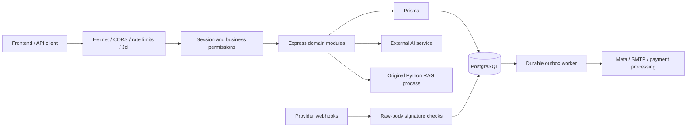

# Whalexy Node backend

Express 5, TypeScript, PostgreSQL and Prisma implementation in this folder. The original Laravel project remains in `../whalexy`. Original Python RAG code remains Python in `python/`; its source hashes are recorded in `migration/python-hashes.json`.

**This is an incomplete migration, not a production replacement.** Read the [module audit](migration/BACKEND_AUDIT.md), [feature coverage and remaining work](migration/FEATURE_PARITY.md), and [verification results](migration/VALIDATION.md). Prisma has 138 models covering all 124 supplied SQLite tables, one additional source-referenced table and 13 native operational tables. All 1,450 SQLite rows have been preserved and hash-verified in a separate PostgreSQL archive. A separate native import validation database contains 1,400 rows verified field by field, 50 quarantined rows verified by hash and 15 restored business-owner memberships. This validation database has not replaced application data. See [SQLite reconciliation](migration/SQLITE_DATABASE_REVIEW.md). The existing frontend has not been switched to these API contracts.

The code layout and layer boundaries are documented in [backend architecture](docs/ARCHITECTURE.md). Run `npm run architecture:check` to enforce boundaries and `npm run format:check` to verify formatting.

## Reading the project

Start with [Reading the code](docs/READING_THE_CODE.md), then the [feature index](docs/FEATURE_INDEX.md). Every feature folder has a README with routes, workflow files and related tests. Source code uses a single implementation path, named operations and separate controller, validation, middleware and service layers.

Use npm run docs:structure to refresh the index/guides, npm run format to format source and tests, and npm run check for architecture, formatting, schema, compiler, regression and build checks.

## Run locally

Native verified ad accounts, campaign/insights and ad/set synchronization, pause/resume, analytics, CSV reports, signed referrals and deduplicated attributed outcomes are documented in [AdsManager workflows](docs/ADS_MANAGER.md).

Native central settings, public Home/legal data and registration controls are documented in [site configuration](docs/SITE_CONFIGURATION.md).

Native localization, the reconciled Portuguese import bundle and workspace setup checks are documented in [localization and guide workflows](docs/LOCALIZATION_AND_GUIDE.md).

Native encrypted Flow setup, catalog mirroring/publishing and catalog messages are documented in [Flow and catalog API workflows](docs/FLOW_AND_CATALOG.md). Their passing tests do not establish original frontend or complete provider parity.

Native manual quotes, receipt submission, reviewed activation, carry-forward periods and payment invoice downloads are documented in [manual billing](docs/MANUAL_BILLING.md). Run `npm run migration:remaining` after the audit/parity commands for the current grouped remaining-work count.

Native Google Sheets automation/script generation and Tally invoice delivery are documented in [Sheets and Tally workflows](docs/SHEETS_AND_TALLY.md), including stable row/invoice identities, supported template mappings, scoped keys and installation steps.

Verified Facebook/Instagram Page-token setup and signed comment/private/public/follow-gate automation are documented in [comment automation workflows](docs/COMMENT_AUTOMATIONS.md), including required permissions and interrupted-effect handling.

Requires Node 22 or later, PostgreSQL 17 and Python 3 for inventory/RAG. On this machine, an isolated PostgreSQL cluster was prepared under `.local/pgdata`, listening on `127.0.0.1:55432`. Development and integration-test databases are separate. `.env` and `.env.test` contain local credentials and must remain private.

```powershell
npm ci
npm run db:generate
npm run db:migrate
npm run dev
```

Run the worker in another terminal so queued messages and email can be processed:

```powershell
npm run worker
```

If the local PostgreSQL cluster has stopped, start it with the installed PostgreSQL binary:

```powershell
& 'C:\Program Files\PostgreSQL\17\bin\pg_ctl.exe' -D '.local/pgdata' -l '.local/postgres.log' -o '-p 55432' start
```

For a different machine, create a PostgreSQL user/database and copy `.env.example` to `.env`. Set `DATABASE_URL`, explicit `CORS_ORIGINS` and `PUBLIC_URL`. Generate a random `JWT_SECRET` of at least 48 characters and a random 32-byte hex `DATA_ENCRYPTION_KEY`, for example using Node's `crypto.randomBytes`. Keep the encryption key backed up securely; changing it without re-encrypting stored credentials makes them unreadable.

SMTP and Twilio Verify credentials are needed for real registration verification. Meta, payment and AI provider credentials are needed for their respective integrations. Unconfigured features return errors or retain blocked jobs. There are no default admin credentials or verification bypasses.

WhatsApp embedded signup requires META_APP_ID, META_APP_SECRET and META_SIGNUP_CONFIG_ID with the configured PUBLIC_URL callback registered in Meta. The client must forward the callback code using its current authenticated session. New native Meta Flow endpoints support provider lifecycle operations and guarded published-flow messages; the original Blade builder, encrypted flow data exchange and social-channel OAuth are not yet ported. Migration 202610030002 adds the native flow ownership/cache table while preserving existing data. See docs/API.md for the current contracts.

Stripe checkout requires `STRIPE_SECRET_KEY` and `BILLING_PLANS`, a server-controlled JSON array of `{id,title,priceId,interval,amount,currency}`. Amounts use the currency's minor unit; intervals are monthly, half_yearly or yearly. Configure matching recurring prices in the Stripe account; neither the source export nor the source default plans supplies usable Stripe price IDs. `PUBLIC_URL` controls checkout and portal return URLs. Only signed events reconciled against Stripe can activate a checkout subscription. CX scoring requires `GROQ_API_KEY` and optionally `GROQ_CX_MODEL`; provider calls and usage billing remain subject to separate live verification.

## Validate legacy data

`npm run db:import-plan` reads the source SQLite file without changing it and reports transformations and quarantine reasons. `npm run db:import-validate` imports into the isolated local `whalexy_import_validation` database and refuses to overwrite populated tables. `node scripts/native_sqlite_import.mjs --verify` rechecks that database without creating it or deploying migrations. The private `legacy_import.quarantine` table retains records with missing required data or references. No account verification is fabricated, no provider credentials are activated, and imported campaigns/flows remain paused or disabled pending workflow conversion. Results are in `migration/native-import-report.json`.

## Verify

```powershell
npm run check
npm run smoke
npm run db:drift
npm run migration:audit
npm run test:evidence
npm audit --omit=dev
npm run parity
```

`check` validates Prisma, checks TypeScript, runs security and real PostgreSQL integration tests, and builds JavaScript. Tests require `.env.test` with `NODE_ENV=test` and database name exactly `whalexy_test`, with migrations applied. Tests create fixture data in that database; never point them at a customer database.

`smoke` starts the compiled app on an ephemeral localhost port, checks both health endpoints over HTTP, and closes the listener.

`parity` deliberately fails while source contracts remain unverified. Its report distinguishes successful tests of the new API from equivalence to the original Laravel contracts. Add mappings only after verifying both behavior and authorization with meaningful tests.

`test:evidence` records named executed tests; `parity` also requires reviewed source/implementation hashes and database, frontend and provider acceptance evidence. A test filename alone is insufficient. The recorded tests verify implemented native behavior; they do not assert full Laravel compatibility.

`npm run migration:inventory` reads the sibling source and writes a schema **draft** into `migration/schema-source.prisma`. It does not replace the active Prisma schema. `--write-schema` is an explicit destructive override for schema regeneration; use only after reviewing a diff. Use new migrations for all changes to deployed databases.

## API and architecture

See [API entry points](docs/API.md) and [operational security notes](docs/OPERATIONS.md).



Production build: `npm run build`, then `npm start`; worker: `node dist/src/worker.js`. Docker and Compose definitions are provided but have not been built here because the Docker daemon is unavailable. Compose needs a strong `POSTGRES_PASSWORD` and production `.env` values with HTTPS origins and public URL. Review the parity report before considering any cutover.
