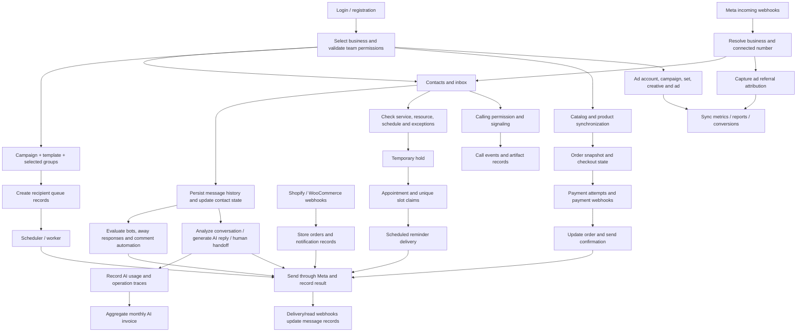

# Whalexy database relationship map

Source project: `D:\mombius bloom\whalexy`. Inventory: **117 distinct literal table names** discovered in migrations, explicit model table declarations, and literal DB/Schema references under app/.

This is a source-derived map, not a live database export. The missing legacy SQL snapshot prevents an exhaustive physical schema audit. Tables referenced by code may be optional, legacy, or not installed. Column lists contain migration-observed names, not complete physical schemas. No source relationships were invented merely to connect isolated tables.

Arrows point from the referencing table to its referenced table. Solid arrows: FK declared in migration source. Dashed arrows: Eloquent/application relationship. Dotted arrows: candidate association inferred from a reference-column name; verify against the live schema. Cardinality is deliberately omitted where uniqueness/nullability is not established. Shared audit/business edges are included.

## Combined table diagram

```mermaid
flowchart LR
    subgraph g0["AI and subscriptions"]
        t10["ai_conversation_handoffs"]
        t11["ai_operation_traces"]
        t47["conversation_ai_analysis"]
        t48["conversation_classification_logs"]
        t49["conversation_classification_tags"]
        t50["conversation_classifications"]
        t51["conversation_cx_scores"]
        t63["manual_subscriptions"]
        t77["subscription_addons"]
        t78["subscriptions"]
        t83["vendor_ai_monthly_invoices"]
        t84["vendor_ai_usages"]
    end
    subgraph g1["Accounts and platform"]
        t0["activity_logs"]
        t41["configurations"]
        t54["countries"]
        t62["login_logs"]
        t68["pending_registrations"]
        t79["token_registry"]
        t81["user_roles"]
        t82["users"]
        t85["vendor_settings"]
        t86["vendor_users"]
        t87["vendors"]
        t88["verifications"]
    end
    subgraph g2["Advertising"]
        t1["ad_accounts"]
        t2["ad_campaign_label"]
        t3["ad_campaigns"]
        t4["ad_conversation_attributions"]
        t5["ad_creatives"]
        t6["ad_labels"]
        t7["ad_notifications"]
        t8["ad_sets"]
        t9["ads"]
        t12["audience_rules"]
        t13["audiences"]
        t22["budgets"]
        t23["campaign_daily_metrics"]
        t25["campaign_logs"]
        t26["campaign_metrics"]
        t27["campaign_templates"]
        t52["conversion_events"]
        t53["conversions"]
        t55["creative_assets"]
        t73["reports"]
    end
    subgraph g3["Appointments"]
        t89["whalexy_appointment_automation_settings"]
        t90["whalexy_appointment_conversation_states"]
        t91["whalexy_appointment_holds"]
        t92["whalexy_appointment_reminder_deliveries"]
        t93["whalexy_appointment_resources"]
        t94["whalexy_appointment_schedule_exceptions"]
        t95["whalexy_appointment_schedules"]
        t96["whalexy_appointment_service_resources"]
        t97["whalexy_appointment_services"]
        t98["whalexy_appointment_slot_claims"]
        t99["whalexy_appointments"]
    end
    subgraph g4["Calling"]
        t101["whatsapp_call_artifacts"]
        t102["whatsapp_call_events"]
        t103["whatsapp_calling_settings"]
        t104["whatsapp_calls"]
    end
    subgraph g5["Campaigns and automation"]
        t18["bot_flow_message_receipts"]
        t19["bot_flows"]
        t20["bot_replies"]
        t24["campaign_groups"]
        t28["campaigns"]
        t39["comment_to_dm_automations"]
        t40["comment_to_dm_executions"]
        t57["google_sheet_automations"]
        t64["out_of_office_deliveries"]
        t65["out_of_office_schedules"]
        t66["out_of_office_settings"]
        t80["user_active_flows"]
        t105["whatsapp_flow_launch_settings"]
        t106["whatsapp_flow_responses"]
    end
    subgraph g6["Catalog and orders"]
        t21["brands"]
        t29["catalog_activity_logs"]
        t30["catalog_connections"]
        t31["catalog_exports"]
        t32["catalog_imports"]
        t33["catalog_settings"]
        t34["catalog_sync_logs"]
        t35["catalogs"]
        t36["categories"]
        t37["collection_products"]
        t38["collections"]
        t69["product_images"]
        t70["product_tags"]
        t71["product_variants"]
        t72["products"]
        t110["whatsapp_orders"]
        t111["whatsapp_payments"]
        t113["whatsapp_user_states"]
    end
    subgraph g7["Contacts and messages"]
        t42["contact_custom_field_values"]
        t43["contact_custom_fields"]
        t44["contact_groups"]
        t45["contact_labels"]
        t46["contacts"]
        t58["group_contacts"]
        t59["instagram_message_logs"]
        t61["labels"]
        t100["whatsapp_blue_tick_applications"]
        t107["whatsapp_message_logs"]
        t108["whatsapp_message_queue"]
        t109["whatsapp_onboarding_connections"]
        t112["whatsapp_templates"]
    end
    subgraph g8["Content and infrastructure"]
        t14["blog_categories"]
        t15["blog_post_tag"]
        t16["blog_posts"]
        t17["blog_tags"]
        t56["failed_jobs"]
        t60["jobs"]
        t67["pages"]
    end
    subgraph g9["Store integrations"]
        t74["shopify_integrations"]
        t75["shopify_order_notifications"]
        t76["shopify_orders"]
        t114["woocommerce_integrations"]
        t115["woocommerce_order_notifications"]
        t116["woocommerce_orders"]
    end
    t1 -->|"created_by"| t82
    t1 -->|"updated_by"| t82
    t1 -->|"organization_id"| t87
    t1 -->|"vendor_id"| t87
    t2 -->|"ad_campaign_id"| t3
    t2 -->|"ad_label_id"| t6
    t2 -->|"created_by"| t82
    t2 -->|"updated_by"| t82
    t2 -->|"organization_id"| t87
    t2 -->|"vendor_id"| t87
    t3 -->|"ad_account_id"| t1
    t3 -->|"created_by"| t82
    t3 -->|"updated_by"| t82
    t3 -->|"organization_id"| t87
    t3 -->|"vendor_id"| t87
    t4 -->|"ad_campaign_id"| t3
    t4 -->|"ad_set_id"| t8
    t4 -->|"ad_id"| t9
    t4 -->|"created_by"| t82
    t4 -->|"updated_by"| t82
    t4 -->|"organization_id"| t87
    t4 -->|"vendor_id"| t87
    t5 -->|"created_by"| t82
    t5 -->|"updated_by"| t82
    t5 -->|"organization_id"| t87
    t5 -->|"vendor_id"| t87
    t6 -->|"created_by"| t82
    t6 -->|"updated_by"| t82
    t6 -->|"organization_id"| t87
    t6 -->|"vendor_id"| t87
    t7 -->|"created_by"| t82
    t7 -->|"updated_by"| t82
    t7 -->|"organization_id"| t87
    t7 -->|"vendor_id"| t87
    t8 -->|"ad_campaign_id"| t3
    t8 -->|"created_by"| t82
    t8 -->|"updated_by"| t82
    t8 -->|"organization_id"| t87
    t8 -->|"vendor_id"| t87
    t9 -->|"ad_creative_id"| t5
    t9 -->|"ad_set_id"| t8
    t9 -->|"created_by"| t82
    t9 -->|"updated_by"| t82
    t9 -->|"organization_id"| t87
    t9 -->|"vendor_id"| t87
    t10 -->|"contacts__id"| t46
    t10 -->|"accepted_by_users__id"| t82
    t10 -->|"assigned_users__id"| t82
    t10 -->|"vendors__id"| t87
    t11 -. "INFER: vendors__id" .-> t87
    t12 -->|"audience_id"| t13
    t12 -->|"created_by"| t82
    t12 -->|"updated_by"| t82
    t12 -->|"organization_id"| t87
    t12 -->|"vendor_id"| t87
    t13 -->|"created_by"| t82
    t13 -->|"updated_by"| t82
    t13 -->|"organization_id"| t87
    t13 -->|"vendor_id"| t87
    t15 -->|"blog_post_id"| t16
    t15 -->|"blog_tag_id"| t17
    t16 -->|"category_id"| t14
    t16 -->|"author_id"| t82
    t18 -. "INFER: vendors__id" .-> t87
    t19 -. "INFER: vendors__id" .-> t87
    t20 -. "APP: bot_flows__id" .-> t19
    t21 -->|"catalog_id"| t35
    t21 -->|"created_by"| t82
    t21 -->|"updated_by"| t82
    t21 -->|"vendor_id"| t87
    t22 -->|"ad_campaign_id"| t3
    t22 -->|"created_by"| t82
    t22 -->|"updated_by"| t82
    t22 -->|"organization_id"| t87
    t22 -->|"vendor_id"| t87
    t23 -->|"ad_campaign_id"| t3
    t23 -->|"created_by"| t82
    t23 -->|"updated_by"| t82
    t23 -->|"organization_id"| t87
    t23 -->|"vendor_id"| t87
    t25 -->|"ad_campaign_id"| t3
    t25 -->|"created_by"| t82
    t25 -->|"updated_by"| t82
    t25 -->|"organization_id"| t87
    t25 -->|"vendor_id"| t87
    t26 -->|"ad_campaign_id"| t3
    t26 -->|"created_by"| t82
    t26 -->|"updated_by"| t82
    t26 -->|"organization_id"| t87
    t26 -->|"vendor_id"| t87
    t27 -->|"created_by"| t82
    t27 -->|"updated_by"| t82
    t27 -->|"organization_id"| t87
    t27 -->|"vendor_id"| t87
    t28 -. "APP: vendors__id" .-> t87
    t28 -. "APP: whatsapp_templates__id" .-> t112
    t29 -->|"catalog_id"| t35
    t29 -->|"created_by"| t82
    t29 -->|"updated_by"| t82
    t29 -->|"vendor_id"| t87
    t30 -->|"catalog_id"| t35
    t30 -->|"created_by"| t82
    t30 -->|"updated_by"| t82
    t30 -->|"vendor_id"| t87
    t31 -->|"catalog_id"| t35
    t31 -->|"created_by"| t82
    t31 -->|"updated_by"| t82
    t31 -->|"vendor_id"| t87
    t32 -->|"catalog_id"| t35
    t32 -->|"created_by"| t82
    t32 -->|"updated_by"| t82
    t32 -->|"vendor_id"| t87
    t33 -->|"catalog_id"| t35
    t33 -->|"created_by"| t82
    t33 -->|"updated_by"| t82
    t33 -->|"vendor_id"| t87
    t34 -->|"catalog_id"| t35
    t34 -->|"created_by"| t82
    t34 -->|"updated_by"| t82
    t34 -->|"vendor_id"| t87
    t35 -->|"created_by"| t82
    t35 -->|"updated_by"| t82
    t35 -->|"vendor_id"| t87
    t36 -->|"catalog_id"| t35
    t36 -->|"parent_id"| t36
    t36 -->|"created_by"| t82
    t36 -->|"updated_by"| t82
    t36 -->|"vendor_id"| t87
    t37 -->|"collection_id"| t38
    t37 -->|"product_id"| t72
    t38 -->|"catalog_id"| t35
    t38 -->|"created_by"| t82
    t38 -->|"updated_by"| t82
    t38 -->|"vendor_id"| t87
    t39 -. "INFER: created_by" .-> t82
    t39 -->|"vendors__id"| t87
    t40 -->|"automation_id"| t39
    t40 -->|"vendors__id"| t87
    t42 -. "APP: contact_custom_fields__id" .-> t43
    t42 -. "APP: contacts__id" .-> t46
    t44 -. "APP: vendors__id" .-> t87
    t45 -. "APP: contacts__id" .-> t46
    t45 -. "APP: labels__id" .-> t61
    t46 -. "APP: countries__id" .-> t54
    t46 -. "APP: vendors__id" .-> t87
    t47 -->|"conversation_id"| t46
    t47 -->|"vendors__id"| t87
    t48 -->|"contacts__id"| t46
    t48 -. "APP: changed_by_users__id" .-> t82
    t48 -->|"vendors__id"| t87
    t49 -. "APP: created_by_users__id" .-> t82
    t49 -->|"vendors__id"| t87
    t50 -->|"contacts__id"| t46
    t50 -. "APP: updated_by_users__id" .-> t82
    t50 -->|"vendors__id"| t87
    t51 -->|"conversation_id"| t46
    t51 -->|"agent_id"| t82
    t51 -->|"vendors__id"| t87
    t52 -->|"conversion_id"| t53
    t52 -->|"created_by"| t82
    t52 -->|"updated_by"| t82
    t52 -->|"organization_id"| t87
    t52 -->|"vendor_id"| t87
    t53 -->|"ad_campaign_id"| t3
    t53 -->|"ad_id"| t9
    t53 -->|"created_by"| t82
    t53 -->|"updated_by"| t82
    t53 -->|"organization_id"| t87
    t53 -->|"vendor_id"| t87
    t55 -->|"ad_creative_id"| t5
    t55 -->|"created_by"| t82
    t55 -->|"updated_by"| t82
    t55 -->|"organization_id"| t87
    t55 -->|"vendor_id"| t87
    t57 -->|"vendors__id"| t87
    t58 -. "APP: contact_groups__id" .-> t44
    t58 -. "APP: contacts__id" .-> t46
    t59 -->|"contacts__id"| t46
    t59 -. "APP: replied_to_instagram_message_logs__uid" .-> t59
    t59 -->|"vendors__id"| t87
    t63 -. "APP: vendors__id" .-> t87
    t64 -. "INFER: contacts__id" .-> t46
    t64 -->|"out_of_office_settings__id"| t66
    t65 -->|"out_of_office_settings__id"| t66
    t66 -. "INFER: vendors__id" .-> t87
    t69 -->|"product_id"| t72
    t69 -->|"created_by"| t82
    t69 -->|"updated_by"| t82
    t69 -->|"vendor_id"| t87
    t70 -->|"product_id"| t72
    t71 -->|"product_id"| t72
    t71 -->|"created_by"| t82
    t71 -->|"updated_by"| t82
    t71 -->|"vendor_id"| t87
    t72 -->|"brand_id"| t21
    t72 -->|"catalog_id"| t35
    t72 -->|"category_id"| t36
    t72 -->|"created_by"| t82
    t72 -->|"updated_by"| t82
    t72 -->|"vendor_id"| t87
    t73 -->|"created_by"| t82
    t73 -->|"updated_by"| t82
    t73 -->|"organization_id"| t87
    t73 -->|"vendor_id"| t87
    t74 -->|"vendors__id"| t87
    t75 -->|"contacts__id"| t46
    t75 -->|"shopify_orders__id"| t76
    t75 -->|"vendors__id"| t87
    t76 -->|"contacts__id"| t46
    t76 -->|"shopify_integrations__id"| t74
    t76 -->|"vendors__id"| t87
    t77 -. "APP: vendors__id" .-> t87
    t80 -. "APP: flow_id" .-> t19
    t82 -. "APP: _id" .-> t46
    t82 -. "APP: user_roles__id" .-> t81
    t82 -. "APP: current_vendor_id" .-> t87
    t82 -. "APP: vendors__id" .-> t87
    t83 -. "APP: vendors__id" .-> t87
    t84 -. "APP: vendors__id" .-> t87
    t85 -. "APP: vendors__id" .-> t87
    t86 -. "APP: users__id" .-> t82
    t86 -. "APP: vendors__id" .-> t87
    t88 -. "INFER: users__id" .-> t82
    t89 -. "INFER: vendors__id" .-> t87
    t90 -. "INFER: contacts__id" .-> t46
    t90 -. "INFER: vendors__id" .-> t87
    t91 -. "INFER: contacts__id" .-> t46
    t91 -. "INFER: vendors__id" .-> t87
    t91 -. "INFER: appointment_resource_id" .-> t93
    t91 -. "INFER: appointment_service_id" .-> t97
    t92 -. "INFER: vendors__id" .-> t87
    t92 -. "INFER: appointment_id" .-> t99
    t93 -. "APP: users__id" .-> t82
    t93 -. "INFER: vendors__id" .-> t87
    t94 -. "INFER: vendors__id" .-> t87
    t94 -. "INFER: appointment_resource_id" .-> t93
    t95 -. "INFER: vendors__id" .-> t87
    t95 -. "INFER: appointment_resource_id" .-> t93
    t96 -. "INFER: vendors__id" .-> t87
    t96 -. "INFER: appointment_resource_id" .-> t93
    t96 -. "INFER: appointment_service_id" .-> t97
    t97 -. "INFER: vendors__id" .-> t87
    t98 -. "INFER: vendors__id" .-> t87
    t98 -. "INFER: appointment_resource_id" .-> t93
    t98 -. "INFER: appointment_id" .-> t99
    t99 -. "INFER: contacts__id" .-> t46
    t99 -. "INFER: vendors__id" .-> t87
    t99 -. "INFER: appointment_resource_id" .-> t93
    t99 -. "INFER: appointment_service_id" .-> t97
    t100 -->|"vendors__id"| t87
    t101 -. "INFER: vendors__id" .-> t87
    t101 -. "INFER: call_id" .-> t104
    t102 -. "INFER: call_id" .-> t104
    t103 -. "INFER: vendors__id" .-> t87
    t104 -. "APP: contact_uid" .-> t46
    t104 -. "INFER: agent_id" .-> t82
    t104 -. "INFER: vendors__id" .-> t87
    t105 -. "INFER: vendors__id" .-> t87
    t106 -. "APP: contacts__id" .-> t46
    t106 -. "INFER: vendors__id" .-> t87
    t107 -. "APP: campaigns__id" .-> t28
    t107 -. "APP: contacts__id" .-> t46
    t107 -. "APP: vendors__id" .-> t87
    t107 -. "APP: replied_to_whatsapp_message_logs__uid" .-> t107
    t108 -. "APP: campaigns__id" .-> t28
    t109 -->|"vendors__id"| t87
    t110 -. "APP: contacts__id" .-> t46
    t110 -. "APP: vendors__id" .-> t87
    t111 -. "APP: vendors__id" .-> t87
    t111 -. "APP: order_id" .-> t110
    t112 -. "APP: vendors__id" .-> t87
    t113 -. "APP: contacts__id" .-> t46
    t113 -. "APP: vendors__id" .-> t87
    t113 -. "APP: order_id" .-> t110
    t114 -->|"vendors__id"| t87
    t115 -->|"contacts__id"| t46
    t115 -->|"vendors__id"| t87
    t115 -->|"whatsapp_templates__id"| t112
    t115 -->|"woocommerce_orders__id"| t116
    t116 -->|"contacts__id"| t46
    t116 -->|"vendors__id"| t87
    t116 -->|"woocommerce_integrations__id"| t114
```

## Operational flow (actions, not foreign keys)

## Relationship register

| Referencing table.column | Referenced table.column | Evidence | Source |
|---|---|---|---|
| `ad_accounts.created_by` | `users._id` | declared | [database/migrations/2026_07_24_200000_create_ads_manager_schema.php](D:/mombius bloom/whalexy/database/migrations/2026_07_24_200000_create_ads_manager_schema.php) |
| `ad_accounts.updated_by` | `users._id` | declared | [database/migrations/2026_07_24_200000_create_ads_manager_schema.php](D:/mombius bloom/whalexy/database/migrations/2026_07_24_200000_create_ads_manager_schema.php) |
| `ad_accounts.organization_id` | `vendors._id` | declared | [database/migrations/2026_07_24_200000_create_ads_manager_schema.php](D:/mombius bloom/whalexy/database/migrations/2026_07_24_200000_create_ads_manager_schema.php) |
| `ad_accounts.vendor_id` | `vendors._id` | declared | [database/migrations/2026_07_24_200000_create_ads_manager_schema.php](D:/mombius bloom/whalexy/database/migrations/2026_07_24_200000_create_ads_manager_schema.php) |
| `ad_campaign_label.ad_campaign_id` | `ad_campaigns.id` | declared | [database/migrations/2026_07_24_200000_create_ads_manager_schema.php](D:/mombius bloom/whalexy/database/migrations/2026_07_24_200000_create_ads_manager_schema.php) |
| `ad_campaign_label.ad_label_id` | `ad_labels.id` | declared | [database/migrations/2026_07_24_200000_create_ads_manager_schema.php](D:/mombius bloom/whalexy/database/migrations/2026_07_24_200000_create_ads_manager_schema.php) |
| `ad_campaign_label.created_by` | `users._id` | declared | [database/migrations/2026_07_24_200000_create_ads_manager_schema.php](D:/mombius bloom/whalexy/database/migrations/2026_07_24_200000_create_ads_manager_schema.php) |
| `ad_campaign_label.updated_by` | `users._id` | declared | [database/migrations/2026_07_24_200000_create_ads_manager_schema.php](D:/mombius bloom/whalexy/database/migrations/2026_07_24_200000_create_ads_manager_schema.php) |
| `ad_campaign_label.organization_id` | `vendors._id` | declared | [database/migrations/2026_07_24_200000_create_ads_manager_schema.php](D:/mombius bloom/whalexy/database/migrations/2026_07_24_200000_create_ads_manager_schema.php) |
| `ad_campaign_label.vendor_id` | `vendors._id` | declared | [database/migrations/2026_07_24_200000_create_ads_manager_schema.php](D:/mombius bloom/whalexy/database/migrations/2026_07_24_200000_create_ads_manager_schema.php) |
| `ad_campaigns.ad_account_id` | `ad_accounts.id` | declared | [database/migrations/2026_07_24_200000_create_ads_manager_schema.php](D:/mombius bloom/whalexy/database/migrations/2026_07_24_200000_create_ads_manager_schema.php) |
| `ad_campaigns.created_by` | `users._id` | declared | [database/migrations/2026_07_24_200000_create_ads_manager_schema.php](D:/mombius bloom/whalexy/database/migrations/2026_07_24_200000_create_ads_manager_schema.php) |
| `ad_campaigns.updated_by` | `users._id` | declared | [database/migrations/2026_07_24_200000_create_ads_manager_schema.php](D:/mombius bloom/whalexy/database/migrations/2026_07_24_200000_create_ads_manager_schema.php) |
| `ad_campaigns.organization_id` | `vendors._id` | declared | [database/migrations/2026_07_24_200000_create_ads_manager_schema.php](D:/mombius bloom/whalexy/database/migrations/2026_07_24_200000_create_ads_manager_schema.php) |
| `ad_campaigns.vendor_id` | `vendors._id` | declared | [database/migrations/2026_07_24_200000_create_ads_manager_schema.php](D:/mombius bloom/whalexy/database/migrations/2026_07_24_200000_create_ads_manager_schema.php) |
| `ad_conversation_attributions.ad_campaign_id` | `ad_campaigns.id` | declared | [database/migrations/2026_07_24_200000_create_ads_manager_schema.php](D:/mombius bloom/whalexy/database/migrations/2026_07_24_200000_create_ads_manager_schema.php) |
| `ad_conversation_attributions.ad_set_id` | `ad_sets.id` | declared | [database/migrations/2026_07_24_200000_create_ads_manager_schema.php](D:/mombius bloom/whalexy/database/migrations/2026_07_24_200000_create_ads_manager_schema.php) |
| `ad_conversation_attributions.ad_id` | `ads.id` | declared | [database/migrations/2026_07_24_200000_create_ads_manager_schema.php](D:/mombius bloom/whalexy/database/migrations/2026_07_24_200000_create_ads_manager_schema.php) |
| `ad_conversation_attributions.created_by` | `users._id` | declared | [database/migrations/2026_07_24_200000_create_ads_manager_schema.php](D:/mombius bloom/whalexy/database/migrations/2026_07_24_200000_create_ads_manager_schema.php) |
| `ad_conversation_attributions.updated_by` | `users._id` | declared | [database/migrations/2026_07_24_200000_create_ads_manager_schema.php](D:/mombius bloom/whalexy/database/migrations/2026_07_24_200000_create_ads_manager_schema.php) |
| `ad_conversation_attributions.organization_id` | `vendors._id` | declared | [database/migrations/2026_07_24_200000_create_ads_manager_schema.php](D:/mombius bloom/whalexy/database/migrations/2026_07_24_200000_create_ads_manager_schema.php) |
| `ad_conversation_attributions.vendor_id` | `vendors._id` | declared | [database/migrations/2026_07_24_200000_create_ads_manager_schema.php](D:/mombius bloom/whalexy/database/migrations/2026_07_24_200000_create_ads_manager_schema.php) |
| `ad_creatives.created_by` | `users._id` | declared | [database/migrations/2026_07_24_200000_create_ads_manager_schema.php](D:/mombius bloom/whalexy/database/migrations/2026_07_24_200000_create_ads_manager_schema.php) |
| `ad_creatives.updated_by` | `users._id` | declared | [database/migrations/2026_07_24_200000_create_ads_manager_schema.php](D:/mombius bloom/whalexy/database/migrations/2026_07_24_200000_create_ads_manager_schema.php) |
| `ad_creatives.organization_id` | `vendors._id` | declared | [database/migrations/2026_07_24_200000_create_ads_manager_schema.php](D:/mombius bloom/whalexy/database/migrations/2026_07_24_200000_create_ads_manager_schema.php) |
| `ad_creatives.vendor_id` | `vendors._id` | declared | [database/migrations/2026_07_24_200000_create_ads_manager_schema.php](D:/mombius bloom/whalexy/database/migrations/2026_07_24_200000_create_ads_manager_schema.php) |
| `ad_labels.created_by` | `users._id` | declared | [database/migrations/2026_07_24_200000_create_ads_manager_schema.php](D:/mombius bloom/whalexy/database/migrations/2026_07_24_200000_create_ads_manager_schema.php) |
| `ad_labels.updated_by` | `users._id` | declared | [database/migrations/2026_07_24_200000_create_ads_manager_schema.php](D:/mombius bloom/whalexy/database/migrations/2026_07_24_200000_create_ads_manager_schema.php) |
| `ad_labels.organization_id` | `vendors._id` | declared | [database/migrations/2026_07_24_200000_create_ads_manager_schema.php](D:/mombius bloom/whalexy/database/migrations/2026_07_24_200000_create_ads_manager_schema.php) |
| `ad_labels.vendor_id` | `vendors._id` | declared | [database/migrations/2026_07_24_200000_create_ads_manager_schema.php](D:/mombius bloom/whalexy/database/migrations/2026_07_24_200000_create_ads_manager_schema.php) |
| `ad_notifications.created_by` | `users._id` | declared | [database/migrations/2026_07_24_200000_create_ads_manager_schema.php](D:/mombius bloom/whalexy/database/migrations/2026_07_24_200000_create_ads_manager_schema.php) |
| `ad_notifications.updated_by` | `users._id` | declared | [database/migrations/2026_07_24_200000_create_ads_manager_schema.php](D:/mombius bloom/whalexy/database/migrations/2026_07_24_200000_create_ads_manager_schema.php) |
| `ad_notifications.organization_id` | `vendors._id` | declared | [database/migrations/2026_07_24_200000_create_ads_manager_schema.php](D:/mombius bloom/whalexy/database/migrations/2026_07_24_200000_create_ads_manager_schema.php) |
| `ad_notifications.vendor_id` | `vendors._id` | declared | [database/migrations/2026_07_24_200000_create_ads_manager_schema.php](D:/mombius bloom/whalexy/database/migrations/2026_07_24_200000_create_ads_manager_schema.php) |
| `ad_sets.ad_campaign_id` | `ad_campaigns.id` | declared | [database/migrations/2026_07_24_200000_create_ads_manager_schema.php](D:/mombius bloom/whalexy/database/migrations/2026_07_24_200000_create_ads_manager_schema.php) |
| `ad_sets.created_by` | `users._id` | declared | [database/migrations/2026_07_24_200000_create_ads_manager_schema.php](D:/mombius bloom/whalexy/database/migrations/2026_07_24_200000_create_ads_manager_schema.php) |
| `ad_sets.updated_by` | `users._id` | declared | [database/migrations/2026_07_24_200000_create_ads_manager_schema.php](D:/mombius bloom/whalexy/database/migrations/2026_07_24_200000_create_ads_manager_schema.php) |
| `ad_sets.organization_id` | `vendors._id` | declared | [database/migrations/2026_07_24_200000_create_ads_manager_schema.php](D:/mombius bloom/whalexy/database/migrations/2026_07_24_200000_create_ads_manager_schema.php) |
| `ad_sets.vendor_id` | `vendors._id` | declared | [database/migrations/2026_07_24_200000_create_ads_manager_schema.php](D:/mombius bloom/whalexy/database/migrations/2026_07_24_200000_create_ads_manager_schema.php) |
| `ads.ad_creative_id` | `ad_creatives.id` | declared | [database/migrations/2026_07_24_200000_create_ads_manager_schema.php](D:/mombius bloom/whalexy/database/migrations/2026_07_24_200000_create_ads_manager_schema.php) |
| `ads.ad_set_id` | `ad_sets.id` | declared | [database/migrations/2026_07_24_200000_create_ads_manager_schema.php](D:/mombius bloom/whalexy/database/migrations/2026_07_24_200000_create_ads_manager_schema.php) |
| `ads.created_by` | `users._id` | declared | [database/migrations/2026_07_24_200000_create_ads_manager_schema.php](D:/mombius bloom/whalexy/database/migrations/2026_07_24_200000_create_ads_manager_schema.php) |
| `ads.updated_by` | `users._id` | declared | [database/migrations/2026_07_24_200000_create_ads_manager_schema.php](D:/mombius bloom/whalexy/database/migrations/2026_07_24_200000_create_ads_manager_schema.php) |
| `ads.organization_id` | `vendors._id` | declared | [database/migrations/2026_07_24_200000_create_ads_manager_schema.php](D:/mombius bloom/whalexy/database/migrations/2026_07_24_200000_create_ads_manager_schema.php) |
| `ads.vendor_id` | `vendors._id` | declared | [database/migrations/2026_07_24_200000_create_ads_manager_schema.php](D:/mombius bloom/whalexy/database/migrations/2026_07_24_200000_create_ads_manager_schema.php) |
| `ai_conversation_handoffs.contacts__id` | `contacts._id` | declared | [database/migrations/2026_09_13_000000_create_ai_conversation_handoffs_table.php](D:/mombius bloom/whalexy/database/migrations/2026_09_13_000000_create_ai_conversation_handoffs_table.php) |
| `ai_conversation_handoffs.accepted_by_users__id` | `users._id` | declared | [database/migrations/2026_09_13_000000_create_ai_conversation_handoffs_table.php](D:/mombius bloom/whalexy/database/migrations/2026_09_13_000000_create_ai_conversation_handoffs_table.php) |
| `ai_conversation_handoffs.assigned_users__id` | `users._id` | declared | [database/migrations/2026_09_13_000000_create_ai_conversation_handoffs_table.php](D:/mombius bloom/whalexy/database/migrations/2026_09_13_000000_create_ai_conversation_handoffs_table.php) |
| `ai_conversation_handoffs.vendors__id` | `vendors._id` | declared | [database/migrations/2026_09_13_000000_create_ai_conversation_handoffs_table.php](D:/mombius bloom/whalexy/database/migrations/2026_09_13_000000_create_ai_conversation_handoffs_table.php) |
| `ai_operation_traces.vendors__id` | `vendors._id` | inferred | [app/Yantrana/Components/AIIntelligence/Models/AIOperationTrace.php](D:/mombius bloom/whalexy/app/Yantrana/Components/AIIntelligence/Models/AIOperationTrace.php) |
| `audience_rules.audience_id` | `audiences.id` | declared | [database/migrations/2026_07_24_200000_create_ads_manager_schema.php](D:/mombius bloom/whalexy/database/migrations/2026_07_24_200000_create_ads_manager_schema.php) |
| `audience_rules.created_by` | `users._id` | declared | [database/migrations/2026_07_24_200000_create_ads_manager_schema.php](D:/mombius bloom/whalexy/database/migrations/2026_07_24_200000_create_ads_manager_schema.php) |
| `audience_rules.updated_by` | `users._id` | declared | [database/migrations/2026_07_24_200000_create_ads_manager_schema.php](D:/mombius bloom/whalexy/database/migrations/2026_07_24_200000_create_ads_manager_schema.php) |
| `audience_rules.organization_id` | `vendors._id` | declared | [database/migrations/2026_07_24_200000_create_ads_manager_schema.php](D:/mombius bloom/whalexy/database/migrations/2026_07_24_200000_create_ads_manager_schema.php) |
| `audience_rules.vendor_id` | `vendors._id` | declared | [database/migrations/2026_07_24_200000_create_ads_manager_schema.php](D:/mombius bloom/whalexy/database/migrations/2026_07_24_200000_create_ads_manager_schema.php) |
| `audiences.created_by` | `users._id` | declared | [database/migrations/2026_07_24_200000_create_ads_manager_schema.php](D:/mombius bloom/whalexy/database/migrations/2026_07_24_200000_create_ads_manager_schema.php) |
| `audiences.updated_by` | `users._id` | declared | [database/migrations/2026_07_24_200000_create_ads_manager_schema.php](D:/mombius bloom/whalexy/database/migrations/2026_07_24_200000_create_ads_manager_schema.php) |
| `audiences.organization_id` | `vendors._id` | declared | [database/migrations/2026_07_24_200000_create_ads_manager_schema.php](D:/mombius bloom/whalexy/database/migrations/2026_07_24_200000_create_ads_manager_schema.php) |
| `audiences.vendor_id` | `vendors._id` | declared | [database/migrations/2026_07_24_200000_create_ads_manager_schema.php](D:/mombius bloom/whalexy/database/migrations/2026_07_24_200000_create_ads_manager_schema.php) |
| `blog_post_tag.blog_post_id` | `blog_posts._id` | declared | [database/migrations/2026_07_15_000300_create_blog_post_tag_table.php](D:/mombius bloom/whalexy/database/migrations/2026_07_15_000300_create_blog_post_tag_table.php) |
| `blog_post_tag.blog_tag_id` | `blog_tags._id` | declared | [database/migrations/2026_07_15_000300_create_blog_post_tag_table.php](D:/mombius bloom/whalexy/database/migrations/2026_07_15_000300_create_blog_post_tag_table.php) |
| `blog_posts.category_id` | `blog_categories._id` | declared | [database/migrations/2026_07_15_000200_create_blog_posts_table.php](D:/mombius bloom/whalexy/database/migrations/2026_07_15_000200_create_blog_posts_table.php) |
| `blog_posts.author_id` | `users._id` | declared | [database/migrations/2026_07_15_000200_create_blog_posts_table.php](D:/mombius bloom/whalexy/database/migrations/2026_07_15_000200_create_blog_posts_table.php) |
| `bot_flow_message_receipts.vendors__id` | `vendors._id` | inferred | [app/Yantrana/Components/BotReply/Messaging/BotFlowMessageRouter.php](D:/mombius bloom/whalexy/app/Yantrana/Components/BotReply/Messaging/BotFlowMessageRouter.php) |
| `bot_flows.vendors__id` | `vendors._id` | inferred | [app/Yantrana/Components/BotReply/Models/BotFlowModel.php](D:/mombius bloom/whalexy/app/Yantrana/Components/BotReply/Models/BotFlowModel.php) |
| `bot_replies.bot_flows__id` | `bot_flows._id` | application | [app/Yantrana/Components/BotReply/Models/BotReplyModel.php](D:/mombius bloom/whalexy/app/Yantrana/Components/BotReply/Models/BotReplyModel.php) |
| `brands.catalog_id` | `catalogs.id` | declared | [database/migrations/2026_07_31_000000_create_catalog_management_schema.php](D:/mombius bloom/whalexy/database/migrations/2026_07_31_000000_create_catalog_management_schema.php) |
| `brands.created_by` | `users._id` | declared | [database/migrations/2026_07_31_000000_create_catalog_management_schema.php](D:/mombius bloom/whalexy/database/migrations/2026_07_31_000000_create_catalog_management_schema.php) |
| `brands.updated_by` | `users._id` | declared | [database/migrations/2026_07_31_000000_create_catalog_management_schema.php](D:/mombius bloom/whalexy/database/migrations/2026_07_31_000000_create_catalog_management_schema.php) |
| `brands.vendor_id` | `vendors._id` | declared | [database/migrations/2026_07_31_000000_create_catalog_management_schema.php](D:/mombius bloom/whalexy/database/migrations/2026_07_31_000000_create_catalog_management_schema.php) |
| `budgets.ad_campaign_id` | `ad_campaigns.id` | declared | [database/migrations/2026_07_24_200000_create_ads_manager_schema.php](D:/mombius bloom/whalexy/database/migrations/2026_07_24_200000_create_ads_manager_schema.php) |
| `budgets.created_by` | `users._id` | declared | [database/migrations/2026_07_24_200000_create_ads_manager_schema.php](D:/mombius bloom/whalexy/database/migrations/2026_07_24_200000_create_ads_manager_schema.php) |
| `budgets.updated_by` | `users._id` | declared | [database/migrations/2026_07_24_200000_create_ads_manager_schema.php](D:/mombius bloom/whalexy/database/migrations/2026_07_24_200000_create_ads_manager_schema.php) |
| `budgets.organization_id` | `vendors._id` | declared | [database/migrations/2026_07_24_200000_create_ads_manager_schema.php](D:/mombius bloom/whalexy/database/migrations/2026_07_24_200000_create_ads_manager_schema.php) |
| `budgets.vendor_id` | `vendors._id` | declared | [database/migrations/2026_07_24_200000_create_ads_manager_schema.php](D:/mombius bloom/whalexy/database/migrations/2026_07_24_200000_create_ads_manager_schema.php) |
| `campaign_daily_metrics.ad_campaign_id` | `ad_campaigns.id` | declared | [database/migrations/2026_07_24_200000_create_ads_manager_schema.php](D:/mombius bloom/whalexy/database/migrations/2026_07_24_200000_create_ads_manager_schema.php) |
| `campaign_daily_metrics.created_by` | `users._id` | declared | [database/migrations/2026_07_24_200000_create_ads_manager_schema.php](D:/mombius bloom/whalexy/database/migrations/2026_07_24_200000_create_ads_manager_schema.php) |
| `campaign_daily_metrics.updated_by` | `users._id` | declared | [database/migrations/2026_07_24_200000_create_ads_manager_schema.php](D:/mombius bloom/whalexy/database/migrations/2026_07_24_200000_create_ads_manager_schema.php) |
| `campaign_daily_metrics.organization_id` | `vendors._id` | declared | [database/migrations/2026_07_24_200000_create_ads_manager_schema.php](D:/mombius bloom/whalexy/database/migrations/2026_07_24_200000_create_ads_manager_schema.php) |
| `campaign_daily_metrics.vendor_id` | `vendors._id` | declared | [database/migrations/2026_07_24_200000_create_ads_manager_schema.php](D:/mombius bloom/whalexy/database/migrations/2026_07_24_200000_create_ads_manager_schema.php) |
| `campaign_logs.ad_campaign_id` | `ad_campaigns.id` | declared | [database/migrations/2026_07_24_200000_create_ads_manager_schema.php](D:/mombius bloom/whalexy/database/migrations/2026_07_24_200000_create_ads_manager_schema.php) |
| `campaign_logs.created_by` | `users._id` | declared | [database/migrations/2026_07_24_200000_create_ads_manager_schema.php](D:/mombius bloom/whalexy/database/migrations/2026_07_24_200000_create_ads_manager_schema.php) |
| `campaign_logs.updated_by` | `users._id` | declared | [database/migrations/2026_07_24_200000_create_ads_manager_schema.php](D:/mombius bloom/whalexy/database/migrations/2026_07_24_200000_create_ads_manager_schema.php) |
| `campaign_logs.organization_id` | `vendors._id` | declared | [database/migrations/2026_07_24_200000_create_ads_manager_schema.php](D:/mombius bloom/whalexy/database/migrations/2026_07_24_200000_create_ads_manager_schema.php) |
| `campaign_logs.vendor_id` | `vendors._id` | declared | [database/migrations/2026_07_24_200000_create_ads_manager_schema.php](D:/mombius bloom/whalexy/database/migrations/2026_07_24_200000_create_ads_manager_schema.php) |
| `campaign_metrics.ad_campaign_id` | `ad_campaigns.id` | declared | [database/migrations/2026_07_24_200000_create_ads_manager_schema.php](D:/mombius bloom/whalexy/database/migrations/2026_07_24_200000_create_ads_manager_schema.php) |
| `campaign_metrics.created_by` | `users._id` | declared | [database/migrations/2026_07_24_200000_create_ads_manager_schema.php](D:/mombius bloom/whalexy/database/migrations/2026_07_24_200000_create_ads_manager_schema.php) |
| `campaign_metrics.updated_by` | `users._id` | declared | [database/migrations/2026_07_24_200000_create_ads_manager_schema.php](D:/mombius bloom/whalexy/database/migrations/2026_07_24_200000_create_ads_manager_schema.php) |
| `campaign_metrics.organization_id` | `vendors._id` | declared | [database/migrations/2026_07_24_200000_create_ads_manager_schema.php](D:/mombius bloom/whalexy/database/migrations/2026_07_24_200000_create_ads_manager_schema.php) |
| `campaign_metrics.vendor_id` | `vendors._id` | declared | [database/migrations/2026_07_24_200000_create_ads_manager_schema.php](D:/mombius bloom/whalexy/database/migrations/2026_07_24_200000_create_ads_manager_schema.php) |
| `campaign_templates.created_by` | `users._id` | declared | [database/migrations/2026_07_24_200000_create_ads_manager_schema.php](D:/mombius bloom/whalexy/database/migrations/2026_07_24_200000_create_ads_manager_schema.php) |
| `campaign_templates.updated_by` | `users._id` | declared | [database/migrations/2026_07_24_200000_create_ads_manager_schema.php](D:/mombius bloom/whalexy/database/migrations/2026_07_24_200000_create_ads_manager_schema.php) |
| `campaign_templates.organization_id` | `vendors._id` | declared | [database/migrations/2026_07_24_200000_create_ads_manager_schema.php](D:/mombius bloom/whalexy/database/migrations/2026_07_24_200000_create_ads_manager_schema.php) |
| `campaign_templates.vendor_id` | `vendors._id` | declared | [database/migrations/2026_07_24_200000_create_ads_manager_schema.php](D:/mombius bloom/whalexy/database/migrations/2026_07_24_200000_create_ads_manager_schema.php) |
| `campaigns.vendors__id` | `vendors._id` | application | [app/Yantrana/Components/Campaign/Repositories/CampaignRepository.php](D:/mombius bloom/whalexy/app/Yantrana/Components/Campaign/Repositories/CampaignRepository.php) |
| `campaigns.whatsapp_templates__id` | `whatsapp_templates._id` | application | [app/Yantrana/Components/Campaign/Models/CampaignModel.php](D:/mombius bloom/whalexy/app/Yantrana/Components/Campaign/Models/CampaignModel.php) |
| `catalog_activity_logs.catalog_id` | `catalogs.id` | declared | [database/migrations/2026_07_31_000000_create_catalog_management_schema.php](D:/mombius bloom/whalexy/database/migrations/2026_07_31_000000_create_catalog_management_schema.php) |
| `catalog_activity_logs.created_by` | `users._id` | declared | [database/migrations/2026_07_31_000000_create_catalog_management_schema.php](D:/mombius bloom/whalexy/database/migrations/2026_07_31_000000_create_catalog_management_schema.php) |
| `catalog_activity_logs.updated_by` | `users._id` | declared | [database/migrations/2026_07_31_000000_create_catalog_management_schema.php](D:/mombius bloom/whalexy/database/migrations/2026_07_31_000000_create_catalog_management_schema.php) |
| `catalog_activity_logs.vendor_id` | `vendors._id` | declared | [database/migrations/2026_07_31_000000_create_catalog_management_schema.php](D:/mombius bloom/whalexy/database/migrations/2026_07_31_000000_create_catalog_management_schema.php) |
| `catalog_connections.catalog_id` | `catalogs.id` | declared | [database/migrations/2026_07_31_000000_create_catalog_management_schema.php](D:/mombius bloom/whalexy/database/migrations/2026_07_31_000000_create_catalog_management_schema.php) |
| `catalog_connections.created_by` | `users._id` | declared | [database/migrations/2026_07_31_000000_create_catalog_management_schema.php](D:/mombius bloom/whalexy/database/migrations/2026_07_31_000000_create_catalog_management_schema.php) |
| `catalog_connections.updated_by` | `users._id` | declared | [database/migrations/2026_07_31_000000_create_catalog_management_schema.php](D:/mombius bloom/whalexy/database/migrations/2026_07_31_000000_create_catalog_management_schema.php) |
| `catalog_connections.vendor_id` | `vendors._id` | declared | [database/migrations/2026_07_31_000000_create_catalog_management_schema.php](D:/mombius bloom/whalexy/database/migrations/2026_07_31_000000_create_catalog_management_schema.php) |
| `catalog_exports.catalog_id` | `catalogs.id` | declared | [database/migrations/2026_07_31_000000_create_catalog_management_schema.php](D:/mombius bloom/whalexy/database/migrations/2026_07_31_000000_create_catalog_management_schema.php) |
| `catalog_exports.created_by` | `users._id` | declared | [database/migrations/2026_07_31_000000_create_catalog_management_schema.php](D:/mombius bloom/whalexy/database/migrations/2026_07_31_000000_create_catalog_management_schema.php) |
| `catalog_exports.updated_by` | `users._id` | declared | [database/migrations/2026_07_31_000000_create_catalog_management_schema.php](D:/mombius bloom/whalexy/database/migrations/2026_07_31_000000_create_catalog_management_schema.php) |
| `catalog_exports.vendor_id` | `vendors._id` | declared | [database/migrations/2026_07_31_000000_create_catalog_management_schema.php](D:/mombius bloom/whalexy/database/migrations/2026_07_31_000000_create_catalog_management_schema.php) |
| `catalog_imports.catalog_id` | `catalogs.id` | declared | [database/migrations/2026_07_31_000000_create_catalog_management_schema.php](D:/mombius bloom/whalexy/database/migrations/2026_07_31_000000_create_catalog_management_schema.php) |
| `catalog_imports.created_by` | `users._id` | declared | [database/migrations/2026_07_31_000000_create_catalog_management_schema.php](D:/mombius bloom/whalexy/database/migrations/2026_07_31_000000_create_catalog_management_schema.php) |
| `catalog_imports.updated_by` | `users._id` | declared | [database/migrations/2026_07_31_000000_create_catalog_management_schema.php](D:/mombius bloom/whalexy/database/migrations/2026_07_31_000000_create_catalog_management_schema.php) |
| `catalog_imports.vendor_id` | `vendors._id` | declared | [database/migrations/2026_07_31_000000_create_catalog_management_schema.php](D:/mombius bloom/whalexy/database/migrations/2026_07_31_000000_create_catalog_management_schema.php) |
| `catalog_settings.catalog_id` | `catalogs.id` | declared | [database/migrations/2026_07_31_000000_create_catalog_management_schema.php](D:/mombius bloom/whalexy/database/migrations/2026_07_31_000000_create_catalog_management_schema.php) |
| `catalog_settings.created_by` | `users._id` | declared | [database/migrations/2026_07_31_000000_create_catalog_management_schema.php](D:/mombius bloom/whalexy/database/migrations/2026_07_31_000000_create_catalog_management_schema.php) |
| `catalog_settings.updated_by` | `users._id` | declared | [database/migrations/2026_07_31_000000_create_catalog_management_schema.php](D:/mombius bloom/whalexy/database/migrations/2026_07_31_000000_create_catalog_management_schema.php) |
| `catalog_settings.vendor_id` | `vendors._id` | declared | [database/migrations/2026_07_31_000000_create_catalog_management_schema.php](D:/mombius bloom/whalexy/database/migrations/2026_07_31_000000_create_catalog_management_schema.php) |
| `catalog_sync_logs.catalog_id` | `catalogs.id` | declared | [database/migrations/2026_07_31_000000_create_catalog_management_schema.php](D:/mombius bloom/whalexy/database/migrations/2026_07_31_000000_create_catalog_management_schema.php) |
| `catalog_sync_logs.created_by` | `users._id` | declared | [database/migrations/2026_07_31_000000_create_catalog_management_schema.php](D:/mombius bloom/whalexy/database/migrations/2026_07_31_000000_create_catalog_management_schema.php) |
| `catalog_sync_logs.updated_by` | `users._id` | declared | [database/migrations/2026_07_31_000000_create_catalog_management_schema.php](D:/mombius bloom/whalexy/database/migrations/2026_07_31_000000_create_catalog_management_schema.php) |
| `catalog_sync_logs.vendor_id` | `vendors._id` | declared | [database/migrations/2026_07_31_000000_create_catalog_management_schema.php](D:/mombius bloom/whalexy/database/migrations/2026_07_31_000000_create_catalog_management_schema.php) |
| `catalogs.created_by` | `users._id` | declared | [database/migrations/2026_07_31_000000_create_catalog_management_schema.php](D:/mombius bloom/whalexy/database/migrations/2026_07_31_000000_create_catalog_management_schema.php) |
| `catalogs.updated_by` | `users._id` | declared | [database/migrations/2026_07_31_000000_create_catalog_management_schema.php](D:/mombius bloom/whalexy/database/migrations/2026_07_31_000000_create_catalog_management_schema.php) |
| `catalogs.vendor_id` | `vendors._id` | declared | [database/migrations/2026_07_31_000000_create_catalog_management_schema.php](D:/mombius bloom/whalexy/database/migrations/2026_07_31_000000_create_catalog_management_schema.php) |
| `categories.catalog_id` | `catalogs.id` | declared | [database/migrations/2026_07_31_000000_create_catalog_management_schema.php](D:/mombius bloom/whalexy/database/migrations/2026_07_31_000000_create_catalog_management_schema.php) |
| `categories.parent_id` | `categories.id` | declared | [database/migrations/2026_07_31_000000_create_catalog_management_schema.php](D:/mombius bloom/whalexy/database/migrations/2026_07_31_000000_create_catalog_management_schema.php) |
| `categories.created_by` | `users._id` | declared | [database/migrations/2026_07_31_000000_create_catalog_management_schema.php](D:/mombius bloom/whalexy/database/migrations/2026_07_31_000000_create_catalog_management_schema.php) |
| `categories.updated_by` | `users._id` | declared | [database/migrations/2026_07_31_000000_create_catalog_management_schema.php](D:/mombius bloom/whalexy/database/migrations/2026_07_31_000000_create_catalog_management_schema.php) |
| `categories.vendor_id` | `vendors._id` | declared | [database/migrations/2026_07_31_000000_create_catalog_management_schema.php](D:/mombius bloom/whalexy/database/migrations/2026_07_31_000000_create_catalog_management_schema.php) |
| `collection_products.collection_id` | `collections.id` | declared | [database/migrations/2026_07_31_000000_create_catalog_management_schema.php](D:/mombius bloom/whalexy/database/migrations/2026_07_31_000000_create_catalog_management_schema.php) |
| `collection_products.product_id` | `products.id` | declared | [database/migrations/2026_07_31_000000_create_catalog_management_schema.php](D:/mombius bloom/whalexy/database/migrations/2026_07_31_000000_create_catalog_management_schema.php) |
| `collections.catalog_id` | `catalogs.id` | declared | [database/migrations/2026_07_31_000000_create_catalog_management_schema.php](D:/mombius bloom/whalexy/database/migrations/2026_07_31_000000_create_catalog_management_schema.php) |
| `collections.created_by` | `users._id` | declared | [database/migrations/2026_07_31_000000_create_catalog_management_schema.php](D:/mombius bloom/whalexy/database/migrations/2026_07_31_000000_create_catalog_management_schema.php) |
| `collections.updated_by` | `users._id` | declared | [database/migrations/2026_07_31_000000_create_catalog_management_schema.php](D:/mombius bloom/whalexy/database/migrations/2026_07_31_000000_create_catalog_management_schema.php) |
| `collections.vendor_id` | `vendors._id` | declared | [database/migrations/2026_07_31_000000_create_catalog_management_schema.php](D:/mombius bloom/whalexy/database/migrations/2026_07_31_000000_create_catalog_management_schema.php) |
| `comment_to_dm_automations.created_by` | `users._id` | inferred | [database/migrations/2026_08_18_010000_create_comment_to_dm_automation_tables.php](D:/mombius bloom/whalexy/database/migrations/2026_08_18_010000_create_comment_to_dm_automation_tables.php) |
| `comment_to_dm_automations.vendors__id` | `vendors._id` | declared | [database/migrations/2026_08_18_010000_create_comment_to_dm_automation_tables.php](D:/mombius bloom/whalexy/database/migrations/2026_08_18_010000_create_comment_to_dm_automation_tables.php) |
| `comment_to_dm_executions.automation_id` | `comment_to_dm_automations.id` | declared | [database/migrations/2026_08_18_010000_create_comment_to_dm_automation_tables.php](D:/mombius bloom/whalexy/database/migrations/2026_08_18_010000_create_comment_to_dm_automation_tables.php) |
| `comment_to_dm_executions.vendors__id` | `vendors._id` | declared | [database/migrations/2026_08_18_010000_create_comment_to_dm_automation_tables.php](D:/mombius bloom/whalexy/database/migrations/2026_08_18_010000_create_comment_to_dm_automation_tables.php) |
| `contact_custom_field_values.contact_custom_fields__id` | `contact_custom_fields._id` | application | [app/Yantrana/Components/Contact/Models/ContactCustomFieldValueModel.php](D:/mombius bloom/whalexy/app/Yantrana/Components/Contact/Models/ContactCustomFieldValueModel.php) |
| `contact_custom_field_values.contacts__id` | `contacts._id` | application | [app/Yantrana/Components/Contact/Models/ContactModel.php](D:/mombius bloom/whalexy/app/Yantrana/Components/Contact/Models/ContactModel.php) |
| `contact_groups.vendors__id` | `vendors._id` | application | [app/Yantrana/Components/Contact/Repositories/ContactGroupRepository.php](D:/mombius bloom/whalexy/app/Yantrana/Components/Contact/Repositories/ContactGroupRepository.php) |
| `contact_labels.contacts__id` | `contacts._id` | application | [app/Yantrana/Components/Contact/Models/ContactModel.php](D:/mombius bloom/whalexy/app/Yantrana/Components/Contact/Models/ContactModel.php) |
| `contact_labels.labels__id` | `labels._id` | application | [app/Yantrana/Components/Contact/Models/ContactModel.php](D:/mombius bloom/whalexy/app/Yantrana/Components/Contact/Models/ContactModel.php) |
| `contacts.countries__id` | `countries._id` | application | [app/Yantrana/Components/Contact/Models/ContactModel.php](D:/mombius bloom/whalexy/app/Yantrana/Components/Contact/Models/ContactModel.php) |
| `contacts.vendors__id` | `vendors._id` | application | [app/Yantrana/Components/Contact/Repositories/ContactRepository.php](D:/mombius bloom/whalexy/app/Yantrana/Components/Contact/Repositories/ContactRepository.php) |
| `conversation_ai_analysis.conversation_id` | `contacts._id` | declared | [database/migrations/2026_07_28_120000_create_conversation_ai_analysis_table.php](D:/mombius bloom/whalexy/database/migrations/2026_07_28_120000_create_conversation_ai_analysis_table.php) |
| `conversation_ai_analysis.vendors__id` | `vendors._id` | declared | [database/migrations/2026_07_28_120000_create_conversation_ai_analysis_table.php](D:/mombius bloom/whalexy/database/migrations/2026_07_28_120000_create_conversation_ai_analysis_table.php) |
| `conversation_classification_logs.contacts__id` | `contacts._id` | declared | [database/migrations/2026_07_27_120000_create_conversation_classification_tables.php](D:/mombius bloom/whalexy/database/migrations/2026_07_27_120000_create_conversation_classification_tables.php) |
| `conversation_classification_logs.changed_by_users__id` | `users._id` | application | [app/Yantrana/Components/ConversationClassification/Models/ConversationClassificationLogModel.php](D:/mombius bloom/whalexy/app/Yantrana/Components/ConversationClassification/Models/ConversationClassificationLogModel.php) |
| `conversation_classification_logs.vendors__id` | `vendors._id` | declared | [database/migrations/2026_07_27_120000_create_conversation_classification_tables.php](D:/mombius bloom/whalexy/database/migrations/2026_07_27_120000_create_conversation_classification_tables.php) |
| `conversation_classification_tags.created_by_users__id` | `users._id` | application | [app/Yantrana/Components/ConversationClassification/Models/ConversationClassificationTagModel.php](D:/mombius bloom/whalexy/app/Yantrana/Components/ConversationClassification/Models/ConversationClassificationTagModel.php) |
| `conversation_classification_tags.vendors__id` | `vendors._id` | declared | [database/migrations/2026_07_27_120000_create_conversation_classification_tables.php](D:/mombius bloom/whalexy/database/migrations/2026_07_27_120000_create_conversation_classification_tables.php) |
| `conversation_classifications.contacts__id` | `contacts._id` | declared | [database/migrations/2026_07_27_120000_create_conversation_classification_tables.php](D:/mombius bloom/whalexy/database/migrations/2026_07_27_120000_create_conversation_classification_tables.php) |
| `conversation_classifications.updated_by_users__id` | `users._id` | application | [app/Yantrana/Components/ConversationClassification/Models/ConversationClassificationModel.php](D:/mombius bloom/whalexy/app/Yantrana/Components/ConversationClassification/Models/ConversationClassificationModel.php) |
| `conversation_classifications.vendors__id` | `vendors._id` | declared | [database/migrations/2026_07_27_120000_create_conversation_classification_tables.php](D:/mombius bloom/whalexy/database/migrations/2026_07_27_120000_create_conversation_classification_tables.php) |
| `conversation_cx_scores.conversation_id` | `contacts._id` | declared | [database/migrations/2026_07_29_120000_create_conversation_cx_scores_table.php](D:/mombius bloom/whalexy/database/migrations/2026_07_29_120000_create_conversation_cx_scores_table.php) |
| `conversation_cx_scores.agent_id` | `users._id` | declared | [database/migrations/2026_07_29_120000_create_conversation_cx_scores_table.php](D:/mombius bloom/whalexy/database/migrations/2026_07_29_120000_create_conversation_cx_scores_table.php) |
| `conversation_cx_scores.vendors__id` | `vendors._id` | declared | [database/migrations/2026_07_29_120000_create_conversation_cx_scores_table.php](D:/mombius bloom/whalexy/database/migrations/2026_07_29_120000_create_conversation_cx_scores_table.php) |
| `conversion_events.conversion_id` | `conversions.id` | declared | [database/migrations/2026_07_24_200000_create_ads_manager_schema.php](D:/mombius bloom/whalexy/database/migrations/2026_07_24_200000_create_ads_manager_schema.php) |
| `conversion_events.created_by` | `users._id` | declared | [database/migrations/2026_07_24_200000_create_ads_manager_schema.php](D:/mombius bloom/whalexy/database/migrations/2026_07_24_200000_create_ads_manager_schema.php) |
| `conversion_events.updated_by` | `users._id` | declared | [database/migrations/2026_07_24_200000_create_ads_manager_schema.php](D:/mombius bloom/whalexy/database/migrations/2026_07_24_200000_create_ads_manager_schema.php) |
| `conversion_events.organization_id` | `vendors._id` | declared | [database/migrations/2026_07_24_200000_create_ads_manager_schema.php](D:/mombius bloom/whalexy/database/migrations/2026_07_24_200000_create_ads_manager_schema.php) |
| `conversion_events.vendor_id` | `vendors._id` | declared | [database/migrations/2026_07_24_200000_create_ads_manager_schema.php](D:/mombius bloom/whalexy/database/migrations/2026_07_24_200000_create_ads_manager_schema.php) |
| `conversions.ad_campaign_id` | `ad_campaigns.id` | declared | [database/migrations/2026_07_24_200000_create_ads_manager_schema.php](D:/mombius bloom/whalexy/database/migrations/2026_07_24_200000_create_ads_manager_schema.php) |
| `conversions.ad_id` | `ads.id` | declared | [database/migrations/2026_07_24_200000_create_ads_manager_schema.php](D:/mombius bloom/whalexy/database/migrations/2026_07_24_200000_create_ads_manager_schema.php) |
| `conversions.created_by` | `users._id` | declared | [database/migrations/2026_07_24_200000_create_ads_manager_schema.php](D:/mombius bloom/whalexy/database/migrations/2026_07_24_200000_create_ads_manager_schema.php) |
| `conversions.updated_by` | `users._id` | declared | [database/migrations/2026_07_24_200000_create_ads_manager_schema.php](D:/mombius bloom/whalexy/database/migrations/2026_07_24_200000_create_ads_manager_schema.php) |
| `conversions.organization_id` | `vendors._id` | declared | [database/migrations/2026_07_24_200000_create_ads_manager_schema.php](D:/mombius bloom/whalexy/database/migrations/2026_07_24_200000_create_ads_manager_schema.php) |
| `conversions.vendor_id` | `vendors._id` | declared | [database/migrations/2026_07_24_200000_create_ads_manager_schema.php](D:/mombius bloom/whalexy/database/migrations/2026_07_24_200000_create_ads_manager_schema.php) |
| `creative_assets.ad_creative_id` | `ad_creatives.id` | declared | [database/migrations/2026_07_24_200000_create_ads_manager_schema.php](D:/mombius bloom/whalexy/database/migrations/2026_07_24_200000_create_ads_manager_schema.php) |
| `creative_assets.created_by` | `users._id` | declared | [database/migrations/2026_07_24_200000_create_ads_manager_schema.php](D:/mombius bloom/whalexy/database/migrations/2026_07_24_200000_create_ads_manager_schema.php) |
| `creative_assets.updated_by` | `users._id` | declared | [database/migrations/2026_07_24_200000_create_ads_manager_schema.php](D:/mombius bloom/whalexy/database/migrations/2026_07_24_200000_create_ads_manager_schema.php) |
| `creative_assets.organization_id` | `vendors._id` | declared | [database/migrations/2026_07_24_200000_create_ads_manager_schema.php](D:/mombius bloom/whalexy/database/migrations/2026_07_24_200000_create_ads_manager_schema.php) |
| `creative_assets.vendor_id` | `vendors._id` | declared | [database/migrations/2026_07_24_200000_create_ads_manager_schema.php](D:/mombius bloom/whalexy/database/migrations/2026_07_24_200000_create_ads_manager_schema.php) |
| `google_sheet_automations.vendors__id` | `vendors._id` | declared | [database/migrations/2026_09_02_160000_create_google_sheet_automations_table.php](D:/mombius bloom/whalexy/database/migrations/2026_09_02_160000_create_google_sheet_automations_table.php) |
| `group_contacts.contact_groups__id` | `contact_groups._id` | application | [app/Yantrana/Components/Contact/Models/ContactGroupModel.php](D:/mombius bloom/whalexy/app/Yantrana/Components/Contact/Models/ContactGroupModel.php) |
| `group_contacts.contacts__id` | `contacts._id` | application | [app/Yantrana/Components/Contact/Models/ContactGroupModel.php](D:/mombius bloom/whalexy/app/Yantrana/Components/Contact/Models/ContactGroupModel.php) |
| `instagram_message_logs.contacts__id` | `contacts._id` | declared | [database/migrations/2026_07_23_180000_create_instagram_messaging_schema.php](D:/mombius bloom/whalexy/database/migrations/2026_07_23_180000_create_instagram_messaging_schema.php) |
| `instagram_message_logs.replied_to_instagram_message_logs__uid` | `instagram_message_logs._uid` | application | [app/Yantrana/Components/InstagramService/Models/InstagramMessageLogModel.php](D:/mombius bloom/whalexy/app/Yantrana/Components/InstagramService/Models/InstagramMessageLogModel.php) |
| `instagram_message_logs.vendors__id` | `vendors._id` | declared | [database/migrations/2026_07_23_180000_create_instagram_messaging_schema.php](D:/mombius bloom/whalexy/database/migrations/2026_07_23_180000_create_instagram_messaging_schema.php) |
| `manual_subscriptions.vendors__id` | `vendors._id` | application | [app/Yantrana/Components/Subscription/Models/ManualSubscriptionModel.php](D:/mombius bloom/whalexy/app/Yantrana/Components/Subscription/Models/ManualSubscriptionModel.php) |
| `out_of_office_deliveries.contacts__id` | `contacts._id` | inferred | [app/Yantrana/Components/OutOfOffice/Models/OutOfOfficeDelivery.php](D:/mombius bloom/whalexy/app/Yantrana/Components/OutOfOffice/Models/OutOfOfficeDelivery.php) |
| `out_of_office_deliveries.out_of_office_settings__id` | `out_of_office_settings._id` | declared | [database/migrations/2026_08_08_000000_create_out_of_office_tables.php](D:/mombius bloom/whalexy/database/migrations/2026_08_08_000000_create_out_of_office_tables.php) |
| `out_of_office_schedules.out_of_office_settings__id` | `out_of_office_settings._id` | declared | [database/migrations/2026_08_08_000000_create_out_of_office_tables.php](D:/mombius bloom/whalexy/database/migrations/2026_08_08_000000_create_out_of_office_tables.php) |
| `out_of_office_settings.vendors__id` | `vendors._id` | inferred | [app/Yantrana/Components/OutOfOffice/Models/OutOfOfficeSetting.php](D:/mombius bloom/whalexy/app/Yantrana/Components/OutOfOffice/Models/OutOfOfficeSetting.php) |
| `product_images.product_id` | `products.id` | declared | [database/migrations/2026_07_31_000000_create_catalog_management_schema.php](D:/mombius bloom/whalexy/database/migrations/2026_07_31_000000_create_catalog_management_schema.php) |
| `product_images.created_by` | `users._id` | declared | [database/migrations/2026_07_31_000000_create_catalog_management_schema.php](D:/mombius bloom/whalexy/database/migrations/2026_07_31_000000_create_catalog_management_schema.php) |
| `product_images.updated_by` | `users._id` | declared | [database/migrations/2026_07_31_000000_create_catalog_management_schema.php](D:/mombius bloom/whalexy/database/migrations/2026_07_31_000000_create_catalog_management_schema.php) |
| `product_images.vendor_id` | `vendors._id` | declared | [database/migrations/2026_07_31_000000_create_catalog_management_schema.php](D:/mombius bloom/whalexy/database/migrations/2026_07_31_000000_create_catalog_management_schema.php) |
| `product_tags.product_id` | `products.id` | declared | [database/migrations/2026_07_31_000000_create_catalog_management_schema.php](D:/mombius bloom/whalexy/database/migrations/2026_07_31_000000_create_catalog_management_schema.php) |
| `product_variants.product_id` | `products.id` | declared | [database/migrations/2026_07_31_000000_create_catalog_management_schema.php](D:/mombius bloom/whalexy/database/migrations/2026_07_31_000000_create_catalog_management_schema.php) |
| `product_variants.created_by` | `users._id` | declared | [database/migrations/2026_07_31_000000_create_catalog_management_schema.php](D:/mombius bloom/whalexy/database/migrations/2026_07_31_000000_create_catalog_management_schema.php) |
| `product_variants.updated_by` | `users._id` | declared | [database/migrations/2026_07_31_000000_create_catalog_management_schema.php](D:/mombius bloom/whalexy/database/migrations/2026_07_31_000000_create_catalog_management_schema.php) |
| `product_variants.vendor_id` | `vendors._id` | declared | [database/migrations/2026_07_31_000000_create_catalog_management_schema.php](D:/mombius bloom/whalexy/database/migrations/2026_07_31_000000_create_catalog_management_schema.php) |
| `products.brand_id` | `brands.id` | declared | [database/migrations/2026_07_31_000000_create_catalog_management_schema.php](D:/mombius bloom/whalexy/database/migrations/2026_07_31_000000_create_catalog_management_schema.php) |
| `products.catalog_id` | `catalogs.id` | declared | [database/migrations/2026_07_31_000000_create_catalog_management_schema.php](D:/mombius bloom/whalexy/database/migrations/2026_07_31_000000_create_catalog_management_schema.php) |
| `products.category_id` | `categories.id` | declared | [database/migrations/2026_07_31_000000_create_catalog_management_schema.php](D:/mombius bloom/whalexy/database/migrations/2026_07_31_000000_create_catalog_management_schema.php) |
| `products.created_by` | `users._id` | declared | [database/migrations/2026_07_31_000000_create_catalog_management_schema.php](D:/mombius bloom/whalexy/database/migrations/2026_07_31_000000_create_catalog_management_schema.php) |
| `products.updated_by` | `users._id` | declared | [database/migrations/2026_07_31_000000_create_catalog_management_schema.php](D:/mombius bloom/whalexy/database/migrations/2026_07_31_000000_create_catalog_management_schema.php) |
| `products.vendor_id` | `vendors._id` | declared | [database/migrations/2026_07_31_000000_create_catalog_management_schema.php](D:/mombius bloom/whalexy/database/migrations/2026_07_31_000000_create_catalog_management_schema.php) |
| `reports.created_by` | `users._id` | declared | [database/migrations/2026_07_24_200000_create_ads_manager_schema.php](D:/mombius bloom/whalexy/database/migrations/2026_07_24_200000_create_ads_manager_schema.php) |
| `reports.updated_by` | `users._id` | declared | [database/migrations/2026_07_24_200000_create_ads_manager_schema.php](D:/mombius bloom/whalexy/database/migrations/2026_07_24_200000_create_ads_manager_schema.php) |
| `reports.organization_id` | `vendors._id` | declared | [database/migrations/2026_07_24_200000_create_ads_manager_schema.php](D:/mombius bloom/whalexy/database/migrations/2026_07_24_200000_create_ads_manager_schema.php) |
| `reports.vendor_id` | `vendors._id` | declared | [database/migrations/2026_07_24_200000_create_ads_manager_schema.php](D:/mombius bloom/whalexy/database/migrations/2026_07_24_200000_create_ads_manager_schema.php) |
| `shopify_integrations.vendors__id` | `vendors._id` | declared | [database/migrations/2025_08_04_064048_create_shopify_integrations_table.php](D:/mombius bloom/whalexy/database/migrations/2025_08_04_064048_create_shopify_integrations_table.php) |
| `shopify_order_notifications.contacts__id` | `contacts._id` | declared | [database/migrations/2025_08_04_064108_create_shopify_order_notifications_table.php](D:/mombius bloom/whalexy/database/migrations/2025_08_04_064108_create_shopify_order_notifications_table.php) |
| `shopify_order_notifications.shopify_orders__id` | `shopify_orders._id` | declared | [database/migrations/2025_08_04_064108_create_shopify_order_notifications_table.php](D:/mombius bloom/whalexy/database/migrations/2025_08_04_064108_create_shopify_order_notifications_table.php) |
| `shopify_order_notifications.vendors__id` | `vendors._id` | declared | [database/migrations/2025_08_04_064108_create_shopify_order_notifications_table.php](D:/mombius bloom/whalexy/database/migrations/2025_08_04_064108_create_shopify_order_notifications_table.php) |
| `shopify_orders.contacts__id` | `contacts._id` | declared | [database/migrations/2025_08_04_064057_create_shopify_orders_table.php](D:/mombius bloom/whalexy/database/migrations/2025_08_04_064057_create_shopify_orders_table.php) |
| `shopify_orders.shopify_integrations__id` | `shopify_integrations._id` | declared | [database/migrations/2025_08_04_064057_create_shopify_orders_table.php](D:/mombius bloom/whalexy/database/migrations/2025_08_04_064057_create_shopify_orders_table.php) |
| `shopify_orders.vendors__id` | `vendors._id` | declared | [database/migrations/2025_08_04_064057_create_shopify_orders_table.php](D:/mombius bloom/whalexy/database/migrations/2025_08_04_064057_create_shopify_orders_table.php) |
| `subscription_addons.vendors__id` | `vendors._id` | application | [app/Yantrana/Components/Subscription/Models/SubscriptionAddonModel.php](D:/mombius bloom/whalexy/app/Yantrana/Components/Subscription/Models/SubscriptionAddonModel.php) |
| `user_active_flows.flow_id` | `bot_flows._id` | application | [app/Models/UserActiveFlow.php](D:/mombius bloom/whalexy/app/Models/UserActiveFlow.php) |
| `users._id` | `contacts.assigned_users__id` | application | [app/Yantrana/Components/Contact/Models/ContactModel.php](D:/mombius bloom/whalexy/app/Yantrana/Components/Contact/Models/ContactModel.php) |
| `users.user_roles__id` | `user_roles._id` | application | [app/Yantrana/Components/Auth/Models/AuthModel.php](D:/mombius bloom/whalexy/app/Yantrana/Components/Auth/Models/AuthModel.php) |
| `users.current_vendor_id` | `vendors._id` | application | [app/Yantrana/Support/app-helpers.php](D:/mombius bloom/whalexy/app/Yantrana/Support/app-helpers.php) |
| `users.vendors__id` | `vendors._id` | application | [app/Yantrana/Components/Auth/Models/AuthModel.php](D:/mombius bloom/whalexy/app/Yantrana/Components/Auth/Models/AuthModel.php) |
| `vendor_ai_monthly_invoices.vendors__id` | `vendors._id` | application | [app/Yantrana/Components/AIIntelligence/Models/VendorAIMonthlyInvoiceModel.php](D:/mombius bloom/whalexy/app/Yantrana/Components/AIIntelligence/Models/VendorAIMonthlyInvoiceModel.php) |
| `vendor_ai_usages.vendors__id` | `vendors._id` | application | [app/Yantrana/Components/AIIntelligence/Models/VendorAIUsageModel.php](D:/mombius bloom/whalexy/app/Yantrana/Components/AIIntelligence/Models/VendorAIUsageModel.php) |
| `vendor_settings.vendors__id` | `vendors._id` | application | [app/Yantrana/Components/Vendor/Repositories/VendorSettingsRepository.php](D:/mombius bloom/whalexy/app/Yantrana/Components/Vendor/Repositories/VendorSettingsRepository.php) |
| `vendor_users.users__id` | `users._id` | application | [app/Yantrana/Components/Auth/Models/AuthModel.php](D:/mombius bloom/whalexy/app/Yantrana/Components/Auth/Models/AuthModel.php) |
| `vendor_users.vendors__id` | `vendors._id` | application | [app/Yantrana/Components/Auth/Models/AuthModel.php](D:/mombius bloom/whalexy/app/Yantrana/Components/Auth/Models/AuthModel.php) |
| `verifications.users__id` | `users._id` | inferred | [app/Yantrana/Components/Auth/Models/ContactVerification.php](D:/mombius bloom/whalexy/app/Yantrana/Components/Auth/Models/ContactVerification.php) |
| `whalexy_appointment_automation_settings.vendors__id` | `vendors._id` | inferred | [app/Yantrana/Components/Appointment/Models/AppointmentAutomationSettingModel.php](D:/mombius bloom/whalexy/app/Yantrana/Components/Appointment/Models/AppointmentAutomationSettingModel.php) |
| `whalexy_appointment_conversation_states.contacts__id` | `contacts._id` | inferred | [app/Yantrana/Components/Appointment/Models/AppointmentConversationStateModel.php](D:/mombius bloom/whalexy/app/Yantrana/Components/Appointment/Models/AppointmentConversationStateModel.php) |
| `whalexy_appointment_conversation_states.vendors__id` | `vendors._id` | inferred | [app/Yantrana/Components/Appointment/Models/AppointmentConversationStateModel.php](D:/mombius bloom/whalexy/app/Yantrana/Components/Appointment/Models/AppointmentConversationStateModel.php) |
| `whalexy_appointment_holds.contacts__id` | `contacts._id` | inferred | [app/Yantrana/Components/Appointment/Models/AppointmentHoldModel.php](D:/mombius bloom/whalexy/app/Yantrana/Components/Appointment/Models/AppointmentHoldModel.php) |
| `whalexy_appointment_holds.vendors__id` | `vendors._id` | inferred | [app/Yantrana/Components/Appointment/Models/AppointmentHoldModel.php](D:/mombius bloom/whalexy/app/Yantrana/Components/Appointment/Models/AppointmentHoldModel.php) |
| `whalexy_appointment_holds.appointment_resource_id` | `whalexy_appointment_resources._id` | inferred | [app/Yantrana/Components/Appointment/Models/AppointmentHoldModel.php](D:/mombius bloom/whalexy/app/Yantrana/Components/Appointment/Models/AppointmentHoldModel.php) |
| `whalexy_appointment_holds.appointment_service_id` | `whalexy_appointment_services._id` | inferred | [app/Yantrana/Components/Appointment/Models/AppointmentHoldModel.php](D:/mombius bloom/whalexy/app/Yantrana/Components/Appointment/Models/AppointmentHoldModel.php) |
| `whalexy_appointment_reminder_deliveries.vendors__id` | `vendors._id` | inferred | [app/Yantrana/Components/Appointment/Services/AppointmentReminderService.php](D:/mombius bloom/whalexy/app/Yantrana/Components/Appointment/Services/AppointmentReminderService.php) |
| `whalexy_appointment_reminder_deliveries.appointment_id` | `whalexy_appointments._id` | inferred | [app/Yantrana/Components/Appointment/Services/AppointmentReminderService.php](D:/mombius bloom/whalexy/app/Yantrana/Components/Appointment/Services/AppointmentReminderService.php) |
| `whalexy_appointment_resources.users__id` | `users._id` | application | [app/Yantrana/Components/Appointment/Models/AppointmentResourceModel.php](D:/mombius bloom/whalexy/app/Yantrana/Components/Appointment/Models/AppointmentResourceModel.php) |
| `whalexy_appointment_resources.vendors__id` | `vendors._id` | inferred | [app/Yantrana/Components/Appointment/Models/AppointmentResourceModel.php](D:/mombius bloom/whalexy/app/Yantrana/Components/Appointment/Models/AppointmentResourceModel.php) |
| `whalexy_appointment_schedule_exceptions.vendors__id` | `vendors._id` | inferred | [app/Yantrana/Components/Appointment/Controllers/AppointmentController.php](D:/mombius bloom/whalexy/app/Yantrana/Components/Appointment/Controllers/AppointmentController.php) |
| `whalexy_appointment_schedule_exceptions.appointment_resource_id` | `whalexy_appointment_resources._id` | inferred | [app/Yantrana/Components/Appointment/Controllers/AppointmentController.php](D:/mombius bloom/whalexy/app/Yantrana/Components/Appointment/Controllers/AppointmentController.php) |
| `whalexy_appointment_schedules.vendors__id` | `vendors._id` | inferred | [app/Yantrana/Components/Appointment/Controllers/AppointmentApiController.php](D:/mombius bloom/whalexy/app/Yantrana/Components/Appointment/Controllers/AppointmentApiController.php) |
| `whalexy_appointment_schedules.appointment_resource_id` | `whalexy_appointment_resources._id` | inferred | [app/Yantrana/Components/Appointment/Controllers/AppointmentApiController.php](D:/mombius bloom/whalexy/app/Yantrana/Components/Appointment/Controllers/AppointmentApiController.php) |
| `whalexy_appointment_service_resources.vendors__id` | `vendors._id` | inferred | [app/Yantrana/Components/Appointment/Controllers/AppointmentApiController.php](D:/mombius bloom/whalexy/app/Yantrana/Components/Appointment/Controllers/AppointmentApiController.php) |
| `whalexy_appointment_service_resources.appointment_resource_id` | `whalexy_appointment_resources._id` | inferred | [app/Yantrana/Components/Appointment/Controllers/AppointmentApiController.php](D:/mombius bloom/whalexy/app/Yantrana/Components/Appointment/Controllers/AppointmentApiController.php) |
| `whalexy_appointment_service_resources.appointment_service_id` | `whalexy_appointment_services._id` | inferred | [app/Yantrana/Components/Appointment/Controllers/AppointmentApiController.php](D:/mombius bloom/whalexy/app/Yantrana/Components/Appointment/Controllers/AppointmentApiController.php) |
| `whalexy_appointment_services.vendors__id` | `vendors._id` | inferred | [app/Yantrana/Components/Appointment/Models/AppointmentServiceModel.php](D:/mombius bloom/whalexy/app/Yantrana/Components/Appointment/Models/AppointmentServiceModel.php) |
| `whalexy_appointment_slot_claims.vendors__id` | `vendors._id` | inferred | [app/Yantrana/Components/Appointment/Services/AppointmentAvailabilityService.php](D:/mombius bloom/whalexy/app/Yantrana/Components/Appointment/Services/AppointmentAvailabilityService.php) |
| `whalexy_appointment_slot_claims.appointment_resource_id` | `whalexy_appointment_resources._id` | inferred | [app/Yantrana/Components/Appointment/Services/AppointmentAvailabilityService.php](D:/mombius bloom/whalexy/app/Yantrana/Components/Appointment/Services/AppointmentAvailabilityService.php) |
| `whalexy_appointment_slot_claims.appointment_id` | `whalexy_appointments._id` | inferred | [app/Yantrana/Components/Appointment/Services/AppointmentAvailabilityService.php](D:/mombius bloom/whalexy/app/Yantrana/Components/Appointment/Services/AppointmentAvailabilityService.php) |
| `whalexy_appointments.contacts__id` | `contacts._id` | inferred | [app/Yantrana/Components/Appointment/Models/AppointmentModel.php](D:/mombius bloom/whalexy/app/Yantrana/Components/Appointment/Models/AppointmentModel.php) |
| `whalexy_appointments.vendors__id` | `vendors._id` | inferred | [app/Yantrana/Components/Appointment/Models/AppointmentModel.php](D:/mombius bloom/whalexy/app/Yantrana/Components/Appointment/Models/AppointmentModel.php) |
| `whalexy_appointments.appointment_resource_id` | `whalexy_appointment_resources._id` | inferred | [app/Yantrana/Components/Appointment/Models/AppointmentModel.php](D:/mombius bloom/whalexy/app/Yantrana/Components/Appointment/Models/AppointmentModel.php) |
| `whalexy_appointments.appointment_service_id` | `whalexy_appointment_services._id` | inferred | [app/Yantrana/Components/Appointment/Models/AppointmentModel.php](D:/mombius bloom/whalexy/app/Yantrana/Components/Appointment/Models/AppointmentModel.php) |
| `whatsapp_blue_tick_applications.vendors__id` | `vendors._id` | declared | [database/migrations/2026_09_01_120000_create_whatsapp_blue_tick_applications_table.php](D:/mombius bloom/whalexy/database/migrations/2026_09_01_120000_create_whatsapp_blue_tick_applications_table.php) |
| `whatsapp_call_artifacts.vendors__id` | `vendors._id` | inferred | [app/Models/WhatsAppCallArtifact.php](D:/mombius bloom/whalexy/app/Models/WhatsAppCallArtifact.php) |
| `whatsapp_call_artifacts.call_id` | `whatsapp_calls.id` | inferred | [app/Models/WhatsAppCallArtifact.php](D:/mombius bloom/whalexy/app/Models/WhatsAppCallArtifact.php) |
| `whatsapp_call_events.call_id` | `whatsapp_calls.id` | inferred | [app/Services/WhatsAppCallingService.php](D:/mombius bloom/whalexy/app/Services/WhatsAppCallingService.php) |
| `whatsapp_calling_settings.vendors__id` | `vendors._id` | inferred | [app/Http/Controllers/WhatsAppCallingController.php](D:/mombius bloom/whalexy/app/Http/Controllers/WhatsAppCallingController.php) |
| `whatsapp_calls.contact_uid` | `contacts._uid` | application | [app/Services/WhatsAppCallingService.php](D:/mombius bloom/whalexy/app/Services/WhatsAppCallingService.php) |
| `whatsapp_calls.agent_id` | `users._id` | inferred | [app/Models/WhatsAppCall.php](D:/mombius bloom/whalexy/app/Models/WhatsAppCall.php) |
| `whatsapp_calls.vendors__id` | `vendors._id` | inferred | [app/Models/WhatsAppCall.php](D:/mombius bloom/whalexy/app/Models/WhatsAppCall.php) |
| `whatsapp_flow_launch_settings.vendors__id` | `vendors._id` | inferred | [app/Yantrana/Components/Flows/Controllers/WhatsAppFlowController.php](D:/mombius bloom/whalexy/app/Yantrana/Components/Flows/Controllers/WhatsAppFlowController.php) |
| `whatsapp_flow_responses.contacts__id` | `contacts._id` | application | [app/Yantrana/Components/Flows/Models/WhatsAppFlowResponseModel.php](D:/mombius bloom/whalexy/app/Yantrana/Components/Flows/Models/WhatsAppFlowResponseModel.php) |
| `whatsapp_flow_responses.vendors__id` | `vendors._id` | inferred | [app/Yantrana/Components/Flows/Models/WhatsAppFlowResponseModel.php](D:/mombius bloom/whalexy/app/Yantrana/Components/Flows/Models/WhatsAppFlowResponseModel.php) |
| `whatsapp_message_logs.campaigns__id` | `campaigns._id` | application | [app/Yantrana/Components/Campaign/Models/CampaignModel.php](D:/mombius bloom/whalexy/app/Yantrana/Components/Campaign/Models/CampaignModel.php) |
| `whatsapp_message_logs.contacts__id` | `contacts._id` | application | [app/Yantrana/Components/Contact/Models/ContactModel.php](D:/mombius bloom/whalexy/app/Yantrana/Components/Contact/Models/ContactModel.php) |
| `whatsapp_message_logs.vendors__id` | `vendors._id` | application | [app/Yantrana/Components/WhatsAppService/Models/WhatsAppMessageLogModel.php](D:/mombius bloom/whalexy/app/Yantrana/Components/WhatsAppService/Models/WhatsAppMessageLogModel.php) |
| `whatsapp_message_logs.replied_to_whatsapp_message_logs__uid` | `whatsapp_message_logs._uid` | application | [app/Yantrana/Components/WhatsAppService/Models/WhatsAppMessageLogModel.php](D:/mombius bloom/whalexy/app/Yantrana/Components/WhatsAppService/Models/WhatsAppMessageLogModel.php) |
| `whatsapp_message_queue.campaigns__id` | `campaigns._id` | application | [app/Yantrana/Components/Campaign/Models/CampaignModel.php](D:/mombius bloom/whalexy/app/Yantrana/Components/Campaign/Models/CampaignModel.php) |
| `whatsapp_onboarding_connections.vendors__id` | `vendors._id` | declared | [database/migrations/2026_08_21_000000_create_whatsapp_onboarding_connections_table.php](D:/mombius bloom/whalexy/database/migrations/2026_08_21_000000_create_whatsapp_onboarding_connections_table.php) |
| `whatsapp_orders.contacts__id` | `contacts._id` | application | [app/Yantrana/Components/WhatsAppService/Models/WhatsAppOrderModel.php](D:/mombius bloom/whalexy/app/Yantrana/Components/WhatsAppService/Models/WhatsAppOrderModel.php) |
| `whatsapp_orders.vendors__id` | `vendors._id` | application | [app/Yantrana/Components/WhatsAppService/Models/WhatsAppOrderModel.php](D:/mombius bloom/whalexy/app/Yantrana/Components/WhatsAppService/Models/WhatsAppOrderModel.php) |
| `whatsapp_payments.vendors__id` | `vendors._id` | application | [app/Yantrana/Components/WhatsAppService/Models/WhatsAppPaymentModel.php](D:/mombius bloom/whalexy/app/Yantrana/Components/WhatsAppService/Models/WhatsAppPaymentModel.php) |
| `whatsapp_payments.order_id` | `whatsapp_orders.order_id` | application | [app/Yantrana/Components/WhatsAppService/Models/WhatsAppOrderModel.php](D:/mombius bloom/whalexy/app/Yantrana/Components/WhatsAppService/Models/WhatsAppOrderModel.php) |
| `whatsapp_templates.vendors__id` | `vendors._id` | application | [app/Yantrana/Components/WhatsAppService/Repositories/WhatsAppTemplateRepository.php](D:/mombius bloom/whalexy/app/Yantrana/Components/WhatsAppService/Repositories/WhatsAppTemplateRepository.php) |
| `whatsapp_user_states.contacts__id` | `contacts._id` | application | [app/Yantrana/Components/WhatsAppService/Models/WhatsAppUserStateModel.php](D:/mombius bloom/whalexy/app/Yantrana/Components/WhatsAppService/Models/WhatsAppUserStateModel.php) |
| `whatsapp_user_states.vendors__id` | `vendors._id` | application | [app/Yantrana/Components/WhatsAppService/Models/WhatsAppUserStateModel.php](D:/mombius bloom/whalexy/app/Yantrana/Components/WhatsAppService/Models/WhatsAppUserStateModel.php) |
| `whatsapp_user_states.order_id` | `whatsapp_orders.order_id` | application | [app/Yantrana/Components/WhatsAppService/Models/WhatsAppOrderModel.php](D:/mombius bloom/whalexy/app/Yantrana/Components/WhatsAppService/Models/WhatsAppOrderModel.php) |
| `woocommerce_integrations.vendors__id` | `vendors._id` | declared | [database/migrations/2025_08_04_064049_create_woocommerce_integrations_table.php](D:/mombius bloom/whalexy/database/migrations/2025_08_04_064049_create_woocommerce_integrations_table.php) |
| `woocommerce_order_notifications.contacts__id` | `contacts._id` | declared | [database/migrations/2025_08_04_064109_create_woocommerce_order_notifications_table.php](D:/mombius bloom/whalexy/database/migrations/2025_08_04_064109_create_woocommerce_order_notifications_table.php) |
| `woocommerce_order_notifications.vendors__id` | `vendors._id` | declared | [database/migrations/2025_08_04_064109_create_woocommerce_order_notifications_table.php](D:/mombius bloom/whalexy/database/migrations/2025_08_04_064109_create_woocommerce_order_notifications_table.php) |
| `woocommerce_order_notifications.whatsapp_templates__id` | `whatsapp_templates._id` | declared | [database/migrations/2025_08_04_064109_create_woocommerce_order_notifications_table.php](D:/mombius bloom/whalexy/database/migrations/2025_08_04_064109_create_woocommerce_order_notifications_table.php) |
| `woocommerce_order_notifications.woocommerce_orders__id` | `woocommerce_orders._id` | declared | [database/migrations/2025_08_04_064109_create_woocommerce_order_notifications_table.php](D:/mombius bloom/whalexy/database/migrations/2025_08_04_064109_create_woocommerce_order_notifications_table.php) |
| `woocommerce_orders.contacts__id` | `contacts._id` | declared | [database/migrations/2025_08_04_064058_create_woocommerce_orders_table.php](D:/mombius bloom/whalexy/database/migrations/2025_08_04_064058_create_woocommerce_orders_table.php) |
| `woocommerce_orders.vendors__id` | `vendors._id` | declared | [database/migrations/2025_08_04_064058_create_woocommerce_orders_table.php](D:/mombius bloom/whalexy/database/migrations/2025_08_04_064058_create_woocommerce_orders_table.php) |
| `woocommerce_orders.woocommerce_integrations__id` | `woocommerce_integrations._id` | declared | [database/migrations/2025_08_04_064058_create_woocommerce_orders_table.php](D:/mombius bloom/whalexy/database/migrations/2025_08_04_064058_create_woocommerce_orders_table.php) |

## Complete discovered table inventory

| Table | Module | CREATE migration found | Source |
|---|---|---|---|
| `activity_logs` | Accounts and platform | No; legacy/reference only | [app/Yantrana/Components/User/Models/ActivityLogModel.php](D:/mombius bloom/whalexy/app/Yantrana/Components/User/Models/ActivityLogModel.php) |
| `ad_accounts` | Advertising | Yes | [database/migrations/2026_07_24_200000_create_ads_manager_schema.php](D:/mombius bloom/whalexy/database/migrations/2026_07_24_200000_create_ads_manager_schema.php) |
| `ad_campaign_label` | Advertising | Yes | [database/migrations/2026_07_24_200000_create_ads_manager_schema.php](D:/mombius bloom/whalexy/database/migrations/2026_07_24_200000_create_ads_manager_schema.php) |
| `ad_campaigns` | Advertising | Yes | [app/Yantrana/Components/AdsManager/Jobs/GenerateAdReport.php](D:/mombius bloom/whalexy/app/Yantrana/Components/AdsManager/Jobs/GenerateAdReport.php) |
| `ad_conversation_attributions` | Advertising | Yes | [app/Yantrana/Components/AdsManager/Controllers/AdsManagerController.php](D:/mombius bloom/whalexy/app/Yantrana/Components/AdsManager/Controllers/AdsManagerController.php) |
| `ad_creatives` | Advertising | Yes | [database/migrations/2026_07_24_200000_create_ads_manager_schema.php](D:/mombius bloom/whalexy/database/migrations/2026_07_24_200000_create_ads_manager_schema.php) |
| `ad_labels` | Advertising | Yes | [database/migrations/2026_07_24_200000_create_ads_manager_schema.php](D:/mombius bloom/whalexy/database/migrations/2026_07_24_200000_create_ads_manager_schema.php) |
| `ad_notifications` | Advertising | Yes | [app/Yantrana/Components/AdsManager/Controllers/AdsManagerController.php](D:/mombius bloom/whalexy/app/Yantrana/Components/AdsManager/Controllers/AdsManagerController.php) |
| `ad_sets` | Advertising | Yes | [database/migrations/2026_07_24_200000_create_ads_manager_schema.php](D:/mombius bloom/whalexy/database/migrations/2026_07_24_200000_create_ads_manager_schema.php) |
| `ads` | Advertising | Yes | [database/migrations/2026_07_24_200000_create_ads_manager_schema.php](D:/mombius bloom/whalexy/database/migrations/2026_07_24_200000_create_ads_manager_schema.php) |
| `ai_conversation_handoffs` | AI and subscriptions | Yes | [app/Services/AiHandoffService.php](D:/mombius bloom/whalexy/app/Services/AiHandoffService.php) |
| `ai_operation_traces` | AI and subscriptions | Yes | [app/Yantrana/Components/AIIntelligence/Models/AIOperationTrace.php](D:/mombius bloom/whalexy/app/Yantrana/Components/AIIntelligence/Models/AIOperationTrace.php) |
| `audience_rules` | Advertising | Yes | [database/migrations/2026_07_24_200000_create_ads_manager_schema.php](D:/mombius bloom/whalexy/database/migrations/2026_07_24_200000_create_ads_manager_schema.php) |
| `audiences` | Advertising | Yes | [database/migrations/2026_07_24_200000_create_ads_manager_schema.php](D:/mombius bloom/whalexy/database/migrations/2026_07_24_200000_create_ads_manager_schema.php) |
| `blog_categories` | Content and infrastructure | Yes | [app/Yantrana/Components/Blog/Models/BlogCategory.php](D:/mombius bloom/whalexy/app/Yantrana/Components/Blog/Models/BlogCategory.php) |
| `blog_post_tag` | Content and infrastructure | Yes | [database/migrations/2026_07_15_000300_create_blog_post_tag_table.php](D:/mombius bloom/whalexy/database/migrations/2026_07_15_000300_create_blog_post_tag_table.php) |
| `blog_posts` | Content and infrastructure | Yes | [app/Yantrana/Components/Blog/Models/BlogPost.php](D:/mombius bloom/whalexy/app/Yantrana/Components/Blog/Models/BlogPost.php) |
| `blog_tags` | Content and infrastructure | Yes | [app/Yantrana/Components/Blog/Models/BlogTag.php](D:/mombius bloom/whalexy/app/Yantrana/Components/Blog/Models/BlogTag.php) |
| `bot_flow_message_receipts` | Campaigns and automation | Yes | [app/Yantrana/Components/BotReply/Messaging/BotFlowMessageRouter.php](D:/mombius bloom/whalexy/app/Yantrana/Components/BotReply/Messaging/BotFlowMessageRouter.php) |
| `bot_flows` | Campaigns and automation | Yes | [app/Yantrana/Components/BotReply/Models/BotFlowModel.php](D:/mombius bloom/whalexy/app/Yantrana/Components/BotReply/Models/BotFlowModel.php) |
| `bot_replies` | Campaigns and automation | No; legacy/reference only | [app/Yantrana/Components/BotReply/Models/BotReplyModel.php](D:/mombius bloom/whalexy/app/Yantrana/Components/BotReply/Models/BotReplyModel.php) |
| `brands` | Catalog and orders | Yes | [database/migrations/2026_07_31_000000_create_catalog_management_schema.php](D:/mombius bloom/whalexy/database/migrations/2026_07_31_000000_create_catalog_management_schema.php) |
| `budgets` | Advertising | Yes | [database/migrations/2026_07_24_200000_create_ads_manager_schema.php](D:/mombius bloom/whalexy/database/migrations/2026_07_24_200000_create_ads_manager_schema.php) |
| `campaign_daily_metrics` | Advertising | Yes | [database/migrations/2026_07_24_200000_create_ads_manager_schema.php](D:/mombius bloom/whalexy/database/migrations/2026_07_24_200000_create_ads_manager_schema.php) |
| `campaign_groups` | Campaigns and automation | No; legacy/reference only | [app/Yantrana/Components/Campaign/Models/CampaignGroupModel.php](D:/mombius bloom/whalexy/app/Yantrana/Components/Campaign/Models/CampaignGroupModel.php) |
| `campaign_logs` | Advertising | Yes | [app/Yantrana/Components/AdsManager/Controllers/AdsManagerController.php](D:/mombius bloom/whalexy/app/Yantrana/Components/AdsManager/Controllers/AdsManagerController.php) |
| `campaign_metrics` | Advertising | Yes | [database/migrations/2026_07_24_200000_create_ads_manager_schema.php](D:/mombius bloom/whalexy/database/migrations/2026_07_24_200000_create_ads_manager_schema.php) |
| `campaign_templates` | Advertising | Yes | [database/migrations/2026_07_24_200000_create_ads_manager_schema.php](D:/mombius bloom/whalexy/database/migrations/2026_07_24_200000_create_ads_manager_schema.php) |
| `campaigns` | Campaigns and automation | No; legacy/reference only | [app/Yantrana/Components/Campaign/Models/CampaignModel.php](D:/mombius bloom/whalexy/app/Yantrana/Components/Campaign/Models/CampaignModel.php) |
| `catalog_activity_logs` | Catalog and orders | Yes | [app/Yantrana/Components/Catalog/Models/CatalogActivityLog.php](D:/mombius bloom/whalexy/app/Yantrana/Components/Catalog/Models/CatalogActivityLog.php) |
| `catalog_connections` | Catalog and orders | Yes | [database/migrations/2026_07_31_000000_create_catalog_management_schema.php](D:/mombius bloom/whalexy/database/migrations/2026_07_31_000000_create_catalog_management_schema.php) |
| `catalog_exports` | Catalog and orders | Yes | [database/migrations/2026_07_31_000000_create_catalog_management_schema.php](D:/mombius bloom/whalexy/database/migrations/2026_07_31_000000_create_catalog_management_schema.php) |
| `catalog_imports` | Catalog and orders | Yes | [database/migrations/2026_07_31_000000_create_catalog_management_schema.php](D:/mombius bloom/whalexy/database/migrations/2026_07_31_000000_create_catalog_management_schema.php) |
| `catalog_settings` | Catalog and orders | Yes | [database/migrations/2026_07_31_000000_create_catalog_management_schema.php](D:/mombius bloom/whalexy/database/migrations/2026_07_31_000000_create_catalog_management_schema.php) |
| `catalog_sync_logs` | Catalog and orders | Yes | [database/migrations/2026_07_31_000000_create_catalog_management_schema.php](D:/mombius bloom/whalexy/database/migrations/2026_07_31_000000_create_catalog_management_schema.php) |
| `catalogs` | Catalog and orders | Yes | [database/migrations/2026_07_31_000000_create_catalog_management_schema.php](D:/mombius bloom/whalexy/database/migrations/2026_07_31_000000_create_catalog_management_schema.php) |
| `categories` | Catalog and orders | Yes | [database/migrations/2026_07_31_000000_create_catalog_management_schema.php](D:/mombius bloom/whalexy/database/migrations/2026_07_31_000000_create_catalog_management_schema.php) |
| `collection_products` | Catalog and orders | Yes | [database/migrations/2026_07_31_000000_create_catalog_management_schema.php](D:/mombius bloom/whalexy/database/migrations/2026_07_31_000000_create_catalog_management_schema.php) |
| `collections` | Catalog and orders | Yes | [database/migrations/2026_07_31_000000_create_catalog_management_schema.php](D:/mombius bloom/whalexy/database/migrations/2026_07_31_000000_create_catalog_management_schema.php) |
| `comment_to_dm_automations` | Campaigns and automation | Yes | [database/migrations/2026_08_18_010000_create_comment_to_dm_automation_tables.php](D:/mombius bloom/whalexy/database/migrations/2026_08_18_010000_create_comment_to_dm_automation_tables.php) |
| `comment_to_dm_executions` | Campaigns and automation | Yes | [database/migrations/2026_08_18_010000_create_comment_to_dm_automation_tables.php](D:/mombius bloom/whalexy/database/migrations/2026_08_18_010000_create_comment_to_dm_automation_tables.php) |
| `configurations` | Accounts and platform | No; legacy/reference only | [app/Providers/AppServiceProvider.php](D:/mombius bloom/whalexy/app/Providers/AppServiceProvider.php) |
| `contact_custom_field_values` | Contacts and messages | No; legacy/reference only | [app/Yantrana/Components/Contact/Models/ContactCustomFieldValueModel.php](D:/mombius bloom/whalexy/app/Yantrana/Components/Contact/Models/ContactCustomFieldValueModel.php) |
| `contact_custom_fields` | Contacts and messages | No; legacy/reference only | [app/Yantrana/Components/Contact/Models/ContactCustomFieldModel.php](D:/mombius bloom/whalexy/app/Yantrana/Components/Contact/Models/ContactCustomFieldModel.php) |
| `contact_groups` | Contacts and messages | No; legacy/reference only | [app/Yantrana/Components/Contact/Models/ContactGroupModel.php](D:/mombius bloom/whalexy/app/Yantrana/Components/Contact/Models/ContactGroupModel.php) |
| `contact_labels` | Contacts and messages | No; legacy/reference only | [app/Yantrana/Components/Contact/Models/ContactLabelModel.php](D:/mombius bloom/whalexy/app/Yantrana/Components/Contact/Models/ContactLabelModel.php) |
| `contacts` | Contacts and messages | No; legacy/reference only | [app/Console/Commands/FixStuckCampaignsCommand.php](D:/mombius bloom/whalexy/app/Console/Commands/FixStuckCampaignsCommand.php) |
| `conversation_ai_analysis` | AI and subscriptions | Yes | [app/Yantrana/Components/AIIntelligence/Models/ConversationAIAnalysis.php](D:/mombius bloom/whalexy/app/Yantrana/Components/AIIntelligence/Models/ConversationAIAnalysis.php) |
| `conversation_classification_logs` | AI and subscriptions | Yes | [app/Yantrana/Components/ConversationClassification/Models/ConversationClassificationLogModel.php](D:/mombius bloom/whalexy/app/Yantrana/Components/ConversationClassification/Models/ConversationClassificationLogModel.php) |
| `conversation_classification_tags` | AI and subscriptions | Yes | [app/Yantrana/Components/ConversationClassification/Models/ConversationClassificationTagModel.php](D:/mombius bloom/whalexy/app/Yantrana/Components/ConversationClassification/Models/ConversationClassificationTagModel.php) |
| `conversation_classifications` | AI and subscriptions | Yes | [app/Yantrana/Components/AIIntelligence/Services/ConversationAnalyzer.php](D:/mombius bloom/whalexy/app/Yantrana/Components/AIIntelligence/Services/ConversationAnalyzer.php) |
| `conversation_cx_scores` | AI and subscriptions | Yes | [app/Yantrana/Components/CXScore/Models/ConversationCXScore.php](D:/mombius bloom/whalexy/app/Yantrana/Components/CXScore/Models/ConversationCXScore.php) |
| `conversion_events` | Advertising | Yes | [app/Yantrana/Components/AdsManager/Controllers/AdsManagerController.php](D:/mombius bloom/whalexy/app/Yantrana/Components/AdsManager/Controllers/AdsManagerController.php) |
| `conversions` | Advertising | Yes | [database/migrations/2026_07_24_200000_create_ads_manager_schema.php](D:/mombius bloom/whalexy/database/migrations/2026_07_24_200000_create_ads_manager_schema.php) |
| `countries` | Accounts and platform | No; legacy/reference only | [app/Yantrana/Support/Country/Models/Country.php](D:/mombius bloom/whalexy/app/Yantrana/Support/Country/Models/Country.php) |
| `creative_assets` | Advertising | Yes | [database/migrations/2026_07_24_200000_create_ads_manager_schema.php](D:/mombius bloom/whalexy/database/migrations/2026_07_24_200000_create_ads_manager_schema.php) |
| `failed_jobs` | Content and infrastructure | Yes | [database/migrations/2026_07_18_170000_create_queue_tables.php](D:/mombius bloom/whalexy/database/migrations/2026_07_18_170000_create_queue_tables.php) |
| `google_sheet_automations` | Campaigns and automation | Yes | [app/Yantrana/Components/Sheets/Models/GoogleSheetAutomationModel.php](D:/mombius bloom/whalexy/app/Yantrana/Components/Sheets/Models/GoogleSheetAutomationModel.php) |
| `group_contacts` | Contacts and messages | No; legacy/reference only | [app/Console/Commands/FixStuckCampaignsCommand.php](D:/mombius bloom/whalexy/app/Console/Commands/FixStuckCampaignsCommand.php) |
| `instagram_message_logs` | Contacts and messages | Yes | [app/Console/Commands/AuditInstagramData.php](D:/mombius bloom/whalexy/app/Console/Commands/AuditInstagramData.php) |
| `jobs` | Content and infrastructure | Yes | [database/migrations/2026_07_18_170000_create_queue_tables.php](D:/mombius bloom/whalexy/database/migrations/2026_07_18_170000_create_queue_tables.php) |
| `labels` | Contacts and messages | No; legacy/reference only | [app/Yantrana/Components/Contact/Models/LabelModel.php](D:/mombius bloom/whalexy/app/Yantrana/Components/Contact/Models/LabelModel.php) |
| `login_logs` | Accounts and platform | No; legacy/reference only | [app/Yantrana/Components/Auth/Models/LoginLogModel.php](D:/mombius bloom/whalexy/app/Yantrana/Components/Auth/Models/LoginLogModel.php) |
| `manual_subscriptions` | AI and subscriptions | No; legacy/reference only | [app/Yantrana/Components/Subscription/Models/ManualSubscriptionModel.php](D:/mombius bloom/whalexy/app/Yantrana/Components/Subscription/Models/ManualSubscriptionModel.php) |
| `out_of_office_deliveries` | Campaigns and automation | Yes | [app/Yantrana/Components/OutOfOffice/Models/OutOfOfficeDelivery.php](D:/mombius bloom/whalexy/app/Yantrana/Components/OutOfOffice/Models/OutOfOfficeDelivery.php) |
| `out_of_office_schedules` | Campaigns and automation | Yes | [app/Yantrana/Components/OutOfOffice/Models/OutOfOfficeSchedule.php](D:/mombius bloom/whalexy/app/Yantrana/Components/OutOfOffice/Models/OutOfOfficeSchedule.php) |
| `out_of_office_settings` | Campaigns and automation | Yes | [app/Yantrana/Components/OutOfOffice/Models/OutOfOfficeSetting.php](D:/mombius bloom/whalexy/app/Yantrana/Components/OutOfOffice/Models/OutOfOfficeSetting.php) |
| `pages` | Content and infrastructure | No; legacy/reference only | [app/Yantrana/Components/Page/Models/PageModel.php](D:/mombius bloom/whalexy/app/Yantrana/Components/Page/Models/PageModel.php) |
| `pending_registrations` | Accounts and platform | Yes | [app/Yantrana/Components/Auth/Models/PendingRegistration.php](D:/mombius bloom/whalexy/app/Yantrana/Components/Auth/Models/PendingRegistration.php) |
| `product_images` | Catalog and orders | Yes | [database/migrations/2026_07_31_000000_create_catalog_management_schema.php](D:/mombius bloom/whalexy/database/migrations/2026_07_31_000000_create_catalog_management_schema.php) |
| `product_tags` | Catalog and orders | Yes | [database/migrations/2026_07_31_000000_create_catalog_management_schema.php](D:/mombius bloom/whalexy/database/migrations/2026_07_31_000000_create_catalog_management_schema.php) |
| `product_variants` | Catalog and orders | Yes | [database/migrations/2026_07_31_000000_create_catalog_management_schema.php](D:/mombius bloom/whalexy/database/migrations/2026_07_31_000000_create_catalog_management_schema.php) |
| `products` | Catalog and orders | Yes | [database/migrations/2026_07_31_000000_create_catalog_management_schema.php](D:/mombius bloom/whalexy/database/migrations/2026_07_31_000000_create_catalog_management_schema.php) |
| `reports` | Advertising | Yes | [app/Yantrana/Components/AdsManager/Models/AdReport.php](D:/mombius bloom/whalexy/app/Yantrana/Components/AdsManager/Models/AdReport.php) |
| `shopify_integrations` | Store integrations | Yes | [app/Yantrana/Components/Integration/Shopify/Models/ShopifyIntegrationModel.php](D:/mombius bloom/whalexy/app/Yantrana/Components/Integration/Shopify/Models/ShopifyIntegrationModel.php) |
| `shopify_order_notifications` | Store integrations | Yes | [app/Yantrana/Components/Integration/Shopify/Models/ShopifyOrderNotificationModel.php](D:/mombius bloom/whalexy/app/Yantrana/Components/Integration/Shopify/Models/ShopifyOrderNotificationModel.php) |
| `shopify_orders` | Store integrations | Yes | [app/Yantrana/Components/Integration/Shopify/Models/ShopifyOrderModel.php](D:/mombius bloom/whalexy/app/Yantrana/Components/Integration/Shopify/Models/ShopifyOrderModel.php) |
| `subscription_addons` | AI and subscriptions | Yes | [app/Yantrana/Components/Subscription/Models/SubscriptionAddonModel.php](D:/mombius bloom/whalexy/app/Yantrana/Components/Subscription/Models/SubscriptionAddonModel.php) |
| `subscriptions` | AI and subscriptions | No; legacy/reference only | [app/Yantrana/Components/Subscription/Models/SubscriptionModel.php](D:/mombius bloom/whalexy/app/Yantrana/Components/Subscription/Models/SubscriptionModel.php) |
| `token_registry` | Accounts and platform | No; legacy/reference only | [app/Yantrana/Services/YesTokenAuth/TokenRegistry/Models/TokenRegistryModel.php](D:/mombius bloom/whalexy/app/Yantrana/Services/YesTokenAuth/TokenRegistry/Models/TokenRegistryModel.php) |
| `user_active_flows` | Campaigns and automation | Yes | [app/Models/UserActiveFlow.php](D:/mombius bloom/whalexy/app/Models/UserActiveFlow.php) |
| `user_roles` | Accounts and platform | No; legacy/reference only | [app/Yantrana/Components/Auth/Models/AuthRoleModel.php](D:/mombius bloom/whalexy/app/Yantrana/Components/Auth/Models/AuthRoleModel.php) |
| `users` | Accounts and platform | No; legacy/reference only | [app/Yantrana/Components/Appointment/Controllers/AppointmentController.php](D:/mombius bloom/whalexy/app/Yantrana/Components/Appointment/Controllers/AppointmentController.php) |
| `vendor_ai_monthly_invoices` | AI and subscriptions | Yes | [app/Yantrana/Components/AIIntelligence/Models/VendorAIMonthlyInvoiceModel.php](D:/mombius bloom/whalexy/app/Yantrana/Components/AIIntelligence/Models/VendorAIMonthlyInvoiceModel.php) |
| `vendor_ai_usages` | AI and subscriptions | Yes | [app/Yantrana/Components/AIIntelligence/Models/VendorAIUsageModel.php](D:/mombius bloom/whalexy/app/Yantrana/Components/AIIntelligence/Models/VendorAIUsageModel.php) |
| `vendor_settings` | Accounts and platform | No; legacy/reference only | [app/Yantrana/Components/Vendor/Models/VendorSettingsModel.php](D:/mombius bloom/whalexy/app/Yantrana/Components/Vendor/Models/VendorSettingsModel.php) |
| `vendor_users` | Accounts and platform | No; legacy/reference only | [app/Yantrana/Components/Appointment/Controllers/AppointmentApiController.php](D:/mombius bloom/whalexy/app/Yantrana/Components/Appointment/Controllers/AppointmentApiController.php) |
| `vendors` | Accounts and platform | No; legacy/reference only | [app/Http/Controllers/WhatsAppCallingController.php](D:/mombius bloom/whalexy/app/Http/Controllers/WhatsAppCallingController.php) |
| `verifications` | Accounts and platform | Yes | [app/Yantrana/Components/Auth/Models/ContactVerification.php](D:/mombius bloom/whalexy/app/Yantrana/Components/Auth/Models/ContactVerification.php) |
| `whalexy_appointment_automation_settings` | Appointments | Yes | [app/Yantrana/Components/Appointment/Models/AppointmentAutomationSettingModel.php](D:/mombius bloom/whalexy/app/Yantrana/Components/Appointment/Models/AppointmentAutomationSettingModel.php) |
| `whalexy_appointment_conversation_states` | Appointments | Yes | [app/Yantrana/Components/Appointment/Models/AppointmentConversationStateModel.php](D:/mombius bloom/whalexy/app/Yantrana/Components/Appointment/Models/AppointmentConversationStateModel.php) |
| `whalexy_appointment_holds` | Appointments | Yes | [app/Yantrana/Components/Appointment/Models/AppointmentHoldModel.php](D:/mombius bloom/whalexy/app/Yantrana/Components/Appointment/Models/AppointmentHoldModel.php) |
| `whalexy_appointment_reminder_deliveries` | Appointments | Yes | [app/Yantrana/Components/Appointment/Services/AppointmentReminderService.php](D:/mombius bloom/whalexy/app/Yantrana/Components/Appointment/Services/AppointmentReminderService.php) |
| `whalexy_appointment_resources` | Appointments | Yes | [app/Yantrana/Components/Appointment/Models/AppointmentResourceModel.php](D:/mombius bloom/whalexy/app/Yantrana/Components/Appointment/Models/AppointmentResourceModel.php) |
| `whalexy_appointment_schedule_exceptions` | Appointments | Yes | [app/Yantrana/Components/Appointment/Controllers/AppointmentController.php](D:/mombius bloom/whalexy/app/Yantrana/Components/Appointment/Controllers/AppointmentController.php) |
| `whalexy_appointment_schedules` | Appointments | Yes | [app/Yantrana/Components/Appointment/Controllers/AppointmentApiController.php](D:/mombius bloom/whalexy/app/Yantrana/Components/Appointment/Controllers/AppointmentApiController.php) |
| `whalexy_appointment_service_resources` | Appointments | Yes | [app/Yantrana/Components/Appointment/Controllers/AppointmentApiController.php](D:/mombius bloom/whalexy/app/Yantrana/Components/Appointment/Controllers/AppointmentApiController.php) |
| `whalexy_appointment_services` | Appointments | Yes | [app/Yantrana/Components/Appointment/Models/AppointmentServiceModel.php](D:/mombius bloom/whalexy/app/Yantrana/Components/Appointment/Models/AppointmentServiceModel.php) |
| `whalexy_appointment_slot_claims` | Appointments | Yes | [app/Yantrana/Components/Appointment/Services/AppointmentAvailabilityService.php](D:/mombius bloom/whalexy/app/Yantrana/Components/Appointment/Services/AppointmentAvailabilityService.php) |
| `whalexy_appointments` | Appointments | Yes | [app/Yantrana/Components/Appointment/Models/AppointmentModel.php](D:/mombius bloom/whalexy/app/Yantrana/Components/Appointment/Models/AppointmentModel.php) |
| `whatsapp_blue_tick_applications` | Contacts and messages | Yes | [app/Yantrana/Components/WhatsAppService/Models/WhatsAppBlueTickApplicationModel.php](D:/mombius bloom/whalexy/app/Yantrana/Components/WhatsAppService/Models/WhatsAppBlueTickApplicationModel.php) |
| `whatsapp_call_artifacts` | Calling | Yes | [app/Models/WhatsAppCallArtifact.php](D:/mombius bloom/whalexy/app/Models/WhatsAppCallArtifact.php) |
| `whatsapp_call_events` | Calling | Yes | [app/Services/WhatsAppCallingService.php](D:/mombius bloom/whalexy/app/Services/WhatsAppCallingService.php) |
| `whatsapp_calling_settings` | Calling | Yes | [app/Http/Controllers/WhatsAppCallingController.php](D:/mombius bloom/whalexy/app/Http/Controllers/WhatsAppCallingController.php) |
| `whatsapp_calls` | Calling | Yes | [app/Models/WhatsAppCall.php](D:/mombius bloom/whalexy/app/Models/WhatsAppCall.php) |
| `whatsapp_flow_launch_settings` | Campaigns and automation | Yes | [app/Yantrana/Components/Flows/Controllers/WhatsAppFlowController.php](D:/mombius bloom/whalexy/app/Yantrana/Components/Flows/Controllers/WhatsAppFlowController.php) |
| `whatsapp_flow_responses` | Campaigns and automation | Yes | [app/Yantrana/Components/Flows/Models/WhatsAppFlowResponseModel.php](D:/mombius bloom/whalexy/app/Yantrana/Components/Flows/Models/WhatsAppFlowResponseModel.php) |
| `whatsapp_message_logs` | Contacts and messages | No; legacy/reference only | [app/Yantrana/Components/AIIntelligence/Services/ConversationAnalyzer.php](D:/mombius bloom/whalexy/app/Yantrana/Components/AIIntelligence/Services/ConversationAnalyzer.php) |
| `whatsapp_message_queue` | Contacts and messages | No; legacy/reference only | [app/Console/Commands/FixStuckCampaignsCommand.php](D:/mombius bloom/whalexy/app/Console/Commands/FixStuckCampaignsCommand.php) |
| `whatsapp_onboarding_connections` | Contacts and messages | Yes | [app/Yantrana/Components/WhatsAppService/Models/WhatsAppOnboardingConnectionModel.php](D:/mombius bloom/whalexy/app/Yantrana/Components/WhatsAppService/Models/WhatsAppOnboardingConnectionModel.php) |
| `whatsapp_orders` | Catalog and orders | Yes | [app/Yantrana/Components/WhatsAppService/Models/WhatsAppOrderModel.php](D:/mombius bloom/whalexy/app/Yantrana/Components/WhatsAppService/Models/WhatsAppOrderModel.php) |
| `whatsapp_payments` | Catalog and orders | Yes | [app/Yantrana/Components/WhatsAppService/Models/WhatsAppPaymentModel.php](D:/mombius bloom/whalexy/app/Yantrana/Components/WhatsAppService/Models/WhatsAppPaymentModel.php) |
| `whatsapp_templates` | Contacts and messages | No; legacy/reference only | [app/Yantrana/Components/Appointment/Services/AppointmentReminderService.php](D:/mombius bloom/whalexy/app/Yantrana/Components/Appointment/Services/AppointmentReminderService.php) |
| `whatsapp_user_states` | Catalog and orders | Yes | [app/Yantrana/Components/WhatsAppService/Models/WhatsAppUserStateModel.php](D:/mombius bloom/whalexy/app/Yantrana/Components/WhatsAppService/Models/WhatsAppUserStateModel.php) |
| `woocommerce_integrations` | Store integrations | Yes | [app/Yantrana/Components/Integration/WooCommerce/Models/WooCommerceIntegrationModel.php](D:/mombius bloom/whalexy/app/Yantrana/Components/Integration/WooCommerce/Models/WooCommerceIntegrationModel.php) |
| `woocommerce_order_notifications` | Store integrations | Yes | [app/Yantrana/Components/Integration/WooCommerce/Models/WooCommerceOrderNotificationModel.php](D:/mombius bloom/whalexy/app/Yantrana/Components/Integration/WooCommerce/Models/WooCommerceOrderNotificationModel.php) |
| `woocommerce_orders` | Store integrations | Yes | [app/Yantrana/Components/Integration/WooCommerce/Models/WooCommerceOrderModel.php](D:/mombius bloom/whalexy/app/Yantrana/Components/Integration/WooCommerce/Models/WooCommerceOrderModel.php) |
